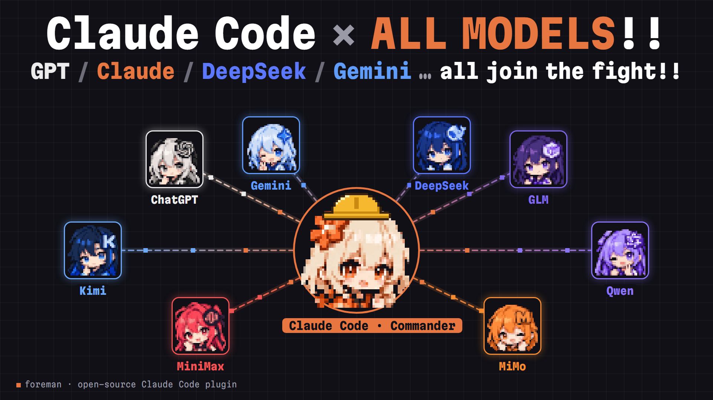
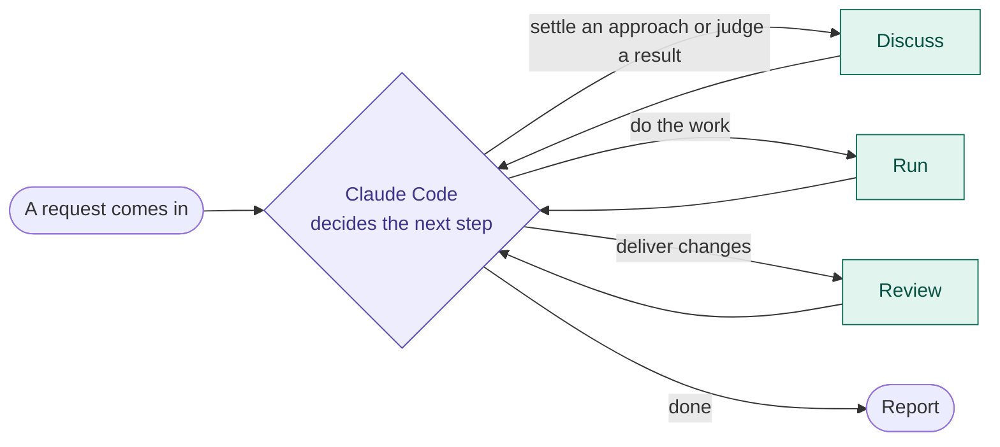
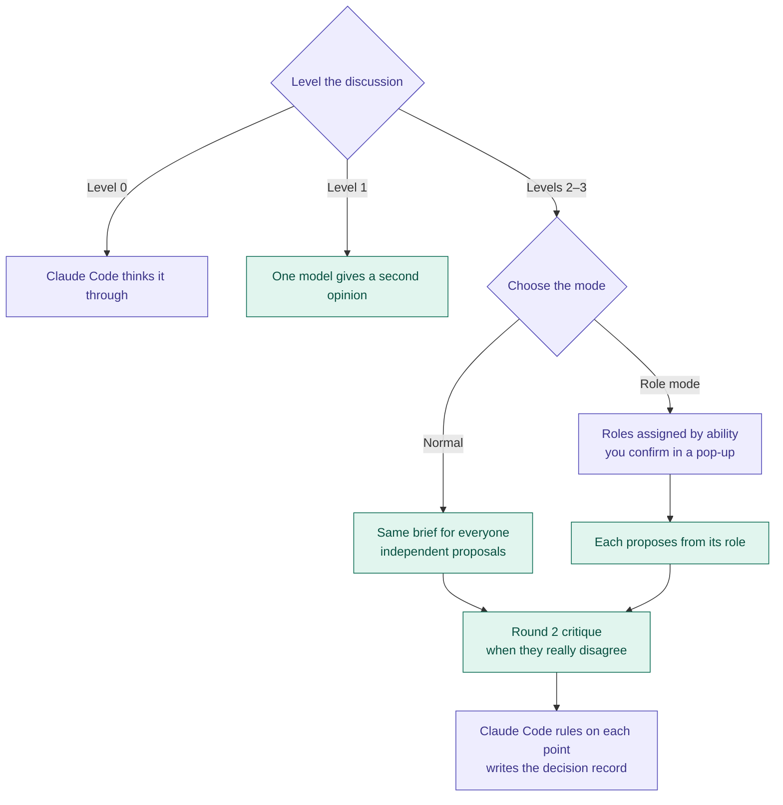
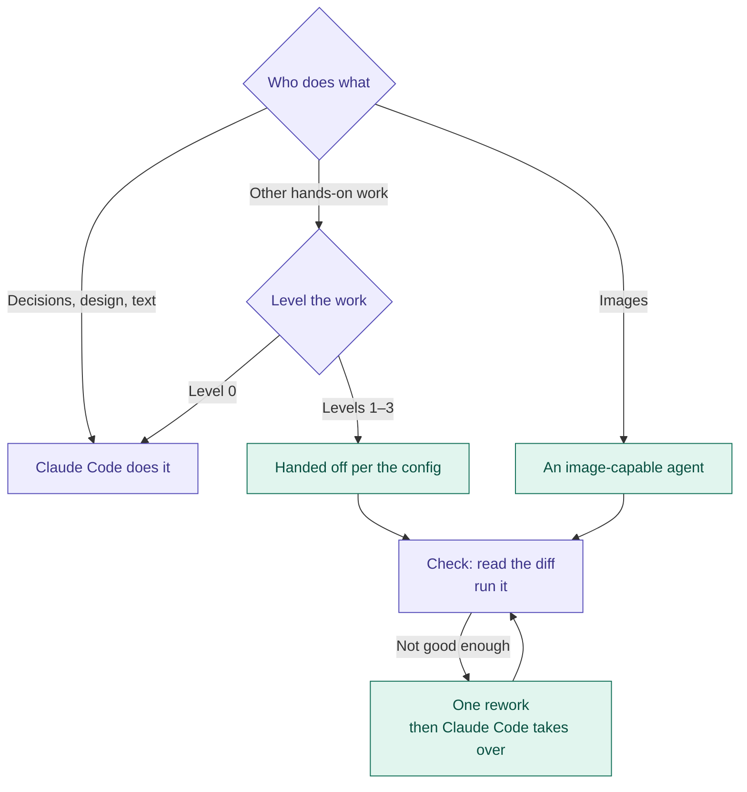
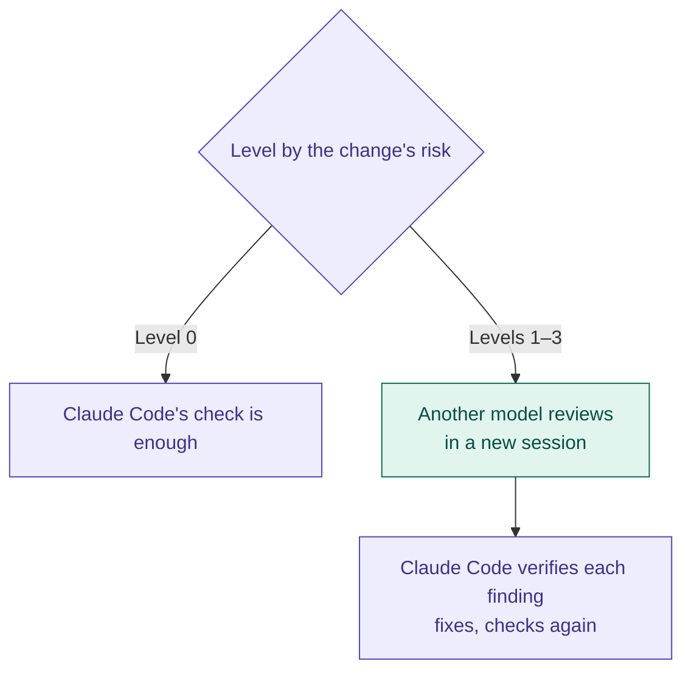

# claude-foreman

[中文](README.md)



A Claude Code plugin that makes Claude Code the foreman: it plans, decides and checks the results, and hands off hands-on coding work to CLI agents such as Codex, opencode and pi according to your config. It can also ask them for independent code reviews, or gather several models to weigh in on a complex design before Claude Code decides.

- **Claude Code checks the work**: Claude Code reviews every diff an agent hands back, runs it to verify, and sends it back for rework if needed. In discussions, the other models' views are input only; Claude Code accepts or rejects each point on its merits.
- **Your own quota**: agents run on your Codex plan, opencode subscription or API credit, not on your Claude Code quota.
- **Visible all the way**: every handoff says who got it, with which model and reasoning effort, and a terminal view shows each model's progress live.

**Intro video**: [watch on Bilibili](https://www.bilibili.com/video/BV16XJv6pE2S/)

## How it works

The plugin has three modules: **discuss**, **run** and **review**. They have no fixed order: after each step Claude Code decides what comes next and goes into whichever module it needs, so one request can use them in any order and more than once. For example "discuss the approach → run → discuss the result → rework → review", or "run → review → discuss a design problem the review raised → run again".



Each time it enters a module, Claude Code levels that step by the module's own criteria. Small things not worth an outside model are level 0, which Claude Code does itself; the rest are simple, normal or complex (`simple` / `normal` / `complex`). Who gets levels 1–3, and with what effort, is up to you in the config, and a level set to `"claude code"` is done by Claude Code itself too. Once something is handed off, a live view in the terminal shows each step the model takes, and at the end Claude Code reports which model did the work and how many tokens it used.

Inside each module (purple steps are done by Claude Code; green ones involve an agent):

**Discuss**



**Run**



**Review**



## What it does

| Command | What it does |
|---|---|
| `/foreman-en:run <task>` | Hands a task to the configured agent. When it finishes, Claude Code reviews the diff, runs it to verify, and sends it back for rework if needed |
| `/foreman-en:review` | Has an agent review uncommitted changes, a branch or a commit. Claude Code checks each finding and filters out false positives |
| `/foreman-en:discuss <topic>` | Several models each propose an approach to a complex design and critique each other's; Claude Code rules on each point and writes up a decision record; topics with competing goals can use role mode, see below |
| `/foreman-en:watch` | Shows what each model is doing, live, in a terminal; see below |
| `/foreman-en:status` | Lists recent runs, or shows the details of one, including token use and Codex quota |
| `/foreman-en:setup` | Setup guide: detects this machine's tools, lists the models available, gives one complete recommendation, and changes the config the way you choose |
| `/foreman-en:config` | Shows or changes the config |

You can also just ask Claude Code to "check the environment" (`check`: whether each agent works, whether its model supports the configured efforts, and whether Codex's sandbox can start) or to "list the available models" (`models`).

### Without commands

The bundled skill has Claude Code level each discussion, piece of hands-on work and review as it comes up, and start what crosses the threshold on its own:

- Before giving an approach, and when judging the result of work already done to decide what to adjust, talk complex, uncertain questions through with other models first; Claude Code rules on the conclusion.
- Before starting work, hand off hands-on work as the levels and config say; work only Claude Code does (decisions, design, text) and level 0 small things aren't handed off.
- Before delivering, decide by the risk of the change whether another model should review it.
- When a big task splits into parts that don't touch each other, hand them to several sessions at once to cut the wait (each agent's limit is `max_parallel`).

If you'd rather Claude Code didn't start these on its own, set `dispatch.auto` to `false`: it asks you before handing off work, starting a discussion or asking for a review.

Only you type the commands in the table above; Claude Code doesn't call them itself. They mean "you asked for this by name" and skip the level 0 check. When Claude Code starts something on its own, it goes through the plugin's skill, which still levels the step and follows `dispatch.auto`.

### Role-mode discussions

When a topic has several goals pulling against each other (such as security and convenience, implementation cost and user experience, compatibility and a rewrite), or it's an evidence review before research conclusions are recorded, a level 2 or 3 discussion can use role mode: each model gets a role card and checks the same topic from one angle, such as architect, math / correctness, fact checker, maintenance and compatibility, user experience or edge-case lister, plus an overall reviewer with no role.

- **Assigned by ability**: first whether the tools can do it (the fact checker has to run commands, so only Codex can take it), then the model tier (roles that need hard thinking only go to strong models), then strengths within the tier. Models are sorted into strong, mid and weak tiers from a third-party leaderboard; see [references/model-tiers.md](foreman-en/skills/dispatch/references/model-tiers.md).
- **One model per role first**: when there aren't enough qualifying models, a strong model opens another session for another role rather than handing it to a model below the role's tier; weak models only take roles where mistakes are cheap, or sit the discussion out.
- **You always confirm first**: before it starts, a pop-up lists the "model → role" assignment, even with `dispatch.auto` on; you can start as suggested, adjust it, or use a normal discussion instead.
- A role only sets what each model checks most closely, not its conclusion; decisions still go by evidence, and several roles agreeing doesn't count as more evidence.
- Custom roles, using role mode by default for some kinds of topics, and a different view of a model's tier can all go in the preference files. The role table and assignment rules are in [references/roles.md](foreman-en/skills/dispatch/references/roles.md).

So that Claude Code doesn't forget (easy when a project has its own skills), the plugin reminds it once at the start of every session and includes your preference files.

### The live view

- The default view is a timeline: times down the left, with what the model says, folded commands and file changes in order, a bottom line that keeps showing elapsed time, command count and progress, and the result at the end.
- While the run is going, the view re-flows when the window is resized. Scroll back with ↑↓, PgUp/PgDn or the mouse wheel, press End to jump to the latest, and q to stop watching; the run keeps going.
- A discussion or task group is shown in one window with a block per model: its status, elapsed time and latest few lines. When the blocks have different titles (a role-mode discussion, split hands-on work), each block's first line is the model and its status and the second is that block's title, with the round for a resumed discussion. When an API model is queued because its service is busy, press x to stop it.
- Add `--verbose` for every detail: reasoning, each command and its output, token use.
- The first time it opens for a newly dispatched conversation, a few seconds of intro play first: the model's pixel avatar, "Starting …" and a few jokes (5 seconds for one model, 10 for a discussion). Any key skips it, and setting `dispatch.intro` to `false` turns it off. The avatar is picked by the model name, with a ??? avatar for anything it doesn't recognize.
- In the Claude desktop app, the live view opens in the terminal panel by itself after each handoff; in the CLI, Claude Code sends you the command to run in another terminal.

## Requirements

- [Claude Code](https://claude.com/claude-code)
- Node.js 18 or later. If you run Claude Code inside WSL, Node.js must be installed inside WSL too, or the plugin's hooks will error before every command
- Git 2.25 or later, used to track which files the agents changed
- Agents, as many as you like (with none, the plugin still installs and Claude Code does all the work itself):
  - The [Codex CLI](https://github.com/openai/codex), installed and signed in. Recommended; image generation can only go to Codex
  - [opencode](https://opencode.ai) 2.x or [pi](https://github.com/earendil-works/pi), to reach models from many providers
  - API keys for models with an OpenAI-compatible API (such as DeepSeek, Kimi or MiMo); these can only join discussions

## Install and setup

**We recommend the Code tab of the Claude desktop app.** The plugin is mainly developed and tested there: after each handoff the live view opens in the terminal panel and comes to the front by itself, and the intro is tuned for the desktop app's terminal. The CLI works too, with the same handoffs, reviews and discussions; the only difference is that you run the live-view command Claude Code gives you in another terminal yourself.

In Claude Code, run:

```
/plugin marketplace add DaydayupV/claude-foreman
/plugin install foreman-en@claude-foreman
```

Then run `/foreman-en:setup`. It detects which tools this machine has, lists the models available and the efforts each supports, and gives one complete recommendation for your situation; after you adjust it item by item, it changes the config and shows an overview: who gets each level of each task type, which agents aren't used, and anything to watch out for. Run it again after installing a new tool or to change models.

Upgrading from codex-bridge? See [below](#upgrading-from-codex-bridge).

## Configuration

The user config is `~/.claude/foreman/config.json`, and a project config is `<project dir>/.claude/foreman.json`. Edit the file directly, or tell Claude Code something like "use `/foreman-en:config` to switch complex tasks to ultra". Every setting is described in [references/config.md](foreman-en/skills/dispatch/references/config.md).

### First run

On first run, the plugin checks what this machine has, then generates a config:

| Found | Resulting setup |
|---|---|
| A usable Codex (installed and signed in) | Claude Code does simple and normal hands-on tasks itself, and complex ones go to Codex's `gpt-6.1-sol`. Reviews and discussions go to Codex, with `gpt-6-astra` for complex ones |
| No Codex | Claude Code does every task itself for now |
| API key environment variables (DeepSeek, Kimi, MiMo) | Added to the config, but not to any discussion yet |
| opencode, pi | Not added automatically; you pick the models |

Choices that cost money or affect safety are never made automatically; `/foreman-en:setup` goes through them with you.

### How the config is laid out

It has three parts:

| Part | What it covers |
|---|---|
| `dispatch` | How the plugin hands off work: whether to do it on its own, the live view, the intro, discussion rounds, time limits, the run directory |
| `agents` | Which agents there are and how to reach them |
| `levels` | Who each level of each task type goes to, and with what effort |

A minimal example: Codex does complex hands-on work and every review, and complex discussions add one model from opencode. Anything left out uses its default.

```json
{
  "agents": {
    "gpt-6.1-sol": { "type": "codex cli", "model": "gpt-6.1-sol" },
    "gpt-6-astra": { "type": "codex cli", "model": "gpt-6-astra" },
    "glm-5.3":     { "type": "opencode cli", "model": "opencode-go/glm-5.3" }
  },
  "levels": {
    "run":     { "simple": "claude code", "normal": "claude code", "complex": { "agent": "gpt-6.1-sol", "effort": "max" } },
    "review":  { "simple": { "agent": "gpt-6.1-sol", "effort": "medium" }, "normal": { "agent": "gpt-6.1-sol", "effort": "high" }, "complex": { "agent": "gpt-6-astra", "effort": "max" } },
    "discuss": { "simple": "claude code", "normal": [{ "agent": "gpt-6.1-sol", "effort": "high" }], "complex": [{ "agent": "gpt-6-astra", "effort": "max" }, { "agent": "glm-5.3" }] }
  }
}
```

- Each key under `agents` is the agent's **ID**, which `levels` and `--agent` refer to. Naming it after its model works best; IDs may use letters, digits, `.`, `-` and `_`.
- Each of the three task types (`run` for hands-on work, `review`, `discuss`) has three levels, plus a level 0 that isn't in the config (see "Task levels" below). Hands-on work and reviews name one agent; discussions name a set of participants.
- `"claude code"` means Claude Code does it itself; for reviews and discussions, that level uses no outside model.
- `effort` is the reasoning effort; leave it out for the default. For Codex it's `low` to `ultra`; for opencode, the model's variant; for pi, its thinking level; for API models it's sent as `reasoning_effort` as is.

### The four kinds of agents

| `type` | What it is | Tasks it can do | Reads code itself | Isolation | Whose quota |
|---|---|---|---|---|---|
| `codex cli` | The Codex CLI on this machine | Hands-on work, reviews, discussions, images | Yes | Codex's own sandbox | Your Codex plan or OpenAI API |
| `opencode cli` | opencode on this machine, with the models it can reach | Reviews and discussions; hands-on work once `run_access` is set | Yes | Limited tools only, no OS sandbox | Providers you signed in to in opencode, or an OpenCode Go subscription |
| `pi cli` | pi on this machine, with the models it can reach | Same as opencode | Yes | Same as opencode, with file paths checked by a guard the plugin injects | Providers you signed in to in pi |
| `api` | A model with an OpenAI-compatible API | Discussions | No; Claude Code attaches the relevant files | Not applicable | The provider's API balance |

You can have several agents of one type, each with a different model. Codex isn't required.

### Task levels

Each time Claude Code enters a discussion, hands-on work or a review, it levels that step by the kind's own criteria; when the same kind comes up again in one request, it's levelled again. The criteria differ by kind:

| Level | Discussion (how uncertain, how costly a wrong choice) | Hands-on work (how much judgement, how costly a mistake) | Review (risk of the change) |
|---|---|---|---|
| 0 | The approach is clear or you've decided: no outside model | A small change done in one place, quicker to make than to brief | Small changes, docs, styling, config, or low-risk changes with tests: Claude Code's check is enough |
| 1 `simple` | A one-off question that needs a second opinion | The method is settled, little judgement needed | Large but mechanical changes |
| 2 `normal` | A few options to compare, limited impact | There's a spec, details need designing | Larger ordinary features and fixes |
| 3 `complex` | Complex, uncertain and costly to get wrong | Unknown cause, costly mistakes, cross-module | High-risk code: money, data, concurrency, auth |

Level 0 is always done by Claude Code and isn't in the config; who gets levels 1–3, and with what effort, is up to you in `levels`. Levels go by judgement and risk, not by how much changes: renaming across 20 files from a list is simple, while changing an interface between modules is complex. Every call that goes out must carry a level; if it's missing, the script errors out rather than quietly picking one.

- To choose on the spot, tell Claude Code "run it with ultra" or "use such-and-such model"; Claude Code switches to `--effort` or `--model`.
- When a level is `"claude code"`, you can still explicitly ask for a task to be handed off, and Claude Code names an agent with `--agent`.
- Level 0 is only for small changes done in one place. By default Claude Code also does `simple` itself; give `simple` to an agent and everything except level 0 changes gets handed off.

### Adding API models

1. **Add the agent**: `{ "type": "api", "base_url": "...", "model": "..." }`. Any OpenAI-compatible API works, such as DeepSeek, Kimi, MiMo, GLM, Qwen or OpenRouter; provider-specific parameters go in `extra_body` and are merged into the request as is.
2. **Fill in the key**, either way:
   - Environment variable: write `"api_key_env": "DEEPSEEK_API_KEY"`, then set that variable. On Windows, add a user variable under "System Properties → Environment Variables"; on macOS and Linux, put it in your shell's startup file. Restart Claude Code so it can see it.
   - Config file: write `"api_key": "sk-..."`. It takes effect immediately but is stored in plain text, so don't commit or share the file. If both are set, the one in the config file wins.
3. **Add it to discussions**: list it at the levels you want under `levels.discuss`.

You can also leave this to `/foreman-en:setup`, for example `/foreman-en:setup add DeepSeek`; you fill in the key yourself, with no need to paste it into the chat. API models can't look through your code themselves, so Claude Code sends the relevant files along with the topic (up to about 300,000 characters each time) and checks what they say about the code against the source.

### Adding opencode

With opencode 2.x installed, any model it can use can join discussions and do reviews, for example GLM, Kimi, Qwen, MiniMax or DeepSeek from an [OpenCode Go](https://opencode.ai/docs/go/) subscription. They read your project's code themselves; the trade-off is that every file they read is another request, which uses more quota.

1. **Sign in**: run `opencode` in a terminal and sign in with `/connect` (choose OpenCode Go for a Go subscription), then run `opencode models` to see which models you can use. Don't configure the free models (names ending in `-free`): OpenCode now only allows them inside its own app, and calls from the command line are refused with "OpenCode's free tier can only be used from within OpenCode".
2. **Add them to the config**: one entry per model, `{ "type": "opencode cli", "model": "opencode-go/glm-5.3" }`, then add it to the levels you want. `/foreman-en:setup` can do this for you.

For discussions and reviews, the plugin gives opencode a read-only agent with only the read, search and list tools; for a review, the plugin works out the changes with git and attaches them. Keys and sign-in stay in opencode. Results include this round's cost (`cost_usd`), which is what OpenCode Go quota is charged by; Go's limits are per model, and premium models have small limits, so keep them for complex discussions.

### Adding pi

With pi installed (`npm install -g @earendil-works/pi-coding-agent`), it works like opencode.

1. **Sign in**: run `pi` in a terminal and sign in to the providers you want with `/login` (or set the provider's API key environment variable), then run `pi --list-models` to see which models you can use.
2. **Add them to the config**: one entry per model, `{ "type": "pi cli", "model": "deepseek/deepseek-flash" }`, then add it to the levels you want.

- The effort is pi's thinking level (`off` to `max`), and each model supports its own set. **If you set a level the model doesn't support, pi doesn't report an error; it quietly switches to the nearest one**, so run `check` after a change: it says which level would be used instead.
- pi has no permission system of its own. Every call from the plugin enables only the tools the task needs and injects a guard extension that keeps file reads and writes inside the project directory; your own extensions, skills and MCP servers aren't loaded. The project's AGENTS.md / CLAUDE.md are read as usual, and sessions stay in pi's default location.

### Letting opencode or pi do hands-on work

Give the agent `run_access` in the user config, then put it in `levels.run` (a project config can't turn this on):

- `"edit"`: reads and writes files in the project directory only, with no commands. Claude Code runs the tests afterwards.
- `"shell"`: can also run commands, such as tests. There's no OS sandbox: its commands run with your account's permissions and can reach the whole machine, so use this only for projects and models you trust.

Both take a change snapshot first, and Claude Code reviews the diff file by file afterwards.

### A complete example

<details>
<summary>Expand: a complete config using all four kinds of agents</summary>

```json
{
  "dispatch": {
    "auto": true,
    "watch": "auto",
    "intro": true,
    "discuss_max_rounds": 2,
    "timeout_min": 240,
    "stall_min": 20,
    "busy_ask_min": 2
  },
  "agents": {
    "gpt-6-astra":        { "type": "codex cli", "model": "gpt-6-astra" },
    "gpt-6.1-sol":        { "type": "codex cli", "model": "gpt-6.1-sol" },
    "deepseek-flash":     { "type": "opencode cli", "model": "deepseek/deepseek-flash" },
    "glm-5.3":            { "type": "opencode cli", "model": "opencode-go/glm-5.3" },
    "mimo-v2.6-pro":      { "type": "pi cli", "model": "xiaomi/mimo-v2.6-pro" },
    "kimi-k2.6":          { "type": "api", "base_url": "https://api.moonshot.cn/v1", "api_key_env": "KIMI_API_KEY", "model": "kimi-k2.6" }
  },
  "levels": {
    "run": {
      "simple":  "claude code",
      "normal":  "claude code",
      "complex": { "agent": "gpt-6.1-sol", "effort": "max" }
    },
    "review": {
      "simple":  { "agent": "gpt-6-astra", "effort": "medium" },
      "normal":  { "agent": "gpt-6-astra", "effort": "high" },
      "complex": { "agent": "gpt-6-astra", "effort": "max" }
    },
    "discuss": {
      "simple": [
        { "agent": "gpt-6-astra", "effort": "medium" },
        { "agent": "glm-5.3" }
      ],
      "normal": [
        { "agent": "gpt-6-astra", "effort": "high" },
        { "agent": "deepseek-flash", "effort": "high" },
        { "agent": "glm-5.3" }
      ],
      "complex": [
        { "agent": "gpt-6-astra", "effort": "max" },
        { "agent": "deepseek-flash", "effort": "max" },
        { "agent": "kimi-k2.6" },
        { "agent": "mimo-v2.6-pro", "effort": "high" },
        { "agent": "glm-5.3" }
      ]
    }
  }
}
```

| ID | Reached through | Used for |
|---|---|---|
| `gpt-6.1-sol` | Codex CLI | Complex hands-on work |
| `gpt-6-astra` | Codex CLI | Every review; joins discussions at all three levels |
| `glm-5.3` | opencode (OpenCode Go subscription) | Joins discussions at all three levels |
| `deepseek-flash` | opencode | Normal and complex discussions |
| `mimo-v2.6-pro` | pi | Complex discussions |
| `kimi-k2.6` | API, with the key in the `KIMI_API_KEY` environment variable | Complex discussions |

Claude Code does simple and normal hands-on work itself, and discussions get more participants as the level rises.

Fields this config doesn't use but that are often adjusted:

```json
"gpt-6.1-sol":        { "type": "codex cli", "model": "gpt-6.1-sol", "sandbox": { "run": "workspace-write" }, "max_parallel": 2 },
"glm-5.3":            { "type": "opencode cli", "model": "opencode-go/glm-5.3", "run_access": "edit" },
"deepseek-v4-pro":    { "type": "api", "base_url": "https://api.deepseek.com", "api_key_env": "DEEPSEEK_API_KEY", "model": "deepseek-v4-pro", "extra_body": { "temperature": 0.3 } }
```

- `sandbox`: the sandbox Codex uses for each task type (`run`, `review`, `discuss`): `read-only`, `workspace-write` or `danger-full-access`. Left out, Codex's own config applies. Don't use `read-only` on Windows.
- `max_parallel`: how many runs this agent may have at once; 4 by default.
- `run_access`: lets opencode or pi do hands-on work; see above.
- `extra_body`: extra parameters to send with API requests.
- `bin`: the full path to the executable, if the command can't be found.

</details>

### Project config

A project config can only tighten, never loosen:

- it only accepts `dispatch.timeout_min`, `dispatch.stall_min`, `dispatch.busy_ask_min` and `levels`;
- each level can only become `"claude code"`, or pick from the agents the user config already has at that level (with a different effort if wanted).

This way a repository you cloned can't use its project config to swap the agent doing the work, send your code to a new provider, or spend your quota on its own. For a sensitive project, keep only Codex in discussions, or set them to `"claude code"`.

### Preference files

Some habits don't fit in JSON, such as which code in your project counts as high-risk, or what you never want handed off. Write those in plain text in a preference file. Claude Code reads it the first time it uses the plugin in a session:

- User level: `~/.claude/foreman/preferences.md`
- Project level: `<project>/.claude/foreman.md`

Preference files win over the plugin's built-in rules, and project level wins over user level. For example:

```markdown
# foreman preferences

- Treat billing and reconciliation code in this project as high-risk: hand it off as complex, and always have Codex review the changes.
- Don't hand off database migration scripts; Claude Code writes them.
- Ask Codex for a review when a change is over 200 lines.
- Use role mode for discussions where performance and maintainability pull against each other; treat kimi-k2.6 as a strong model.
```

Custom roles for role-mode discussions go here too; the format is under "Custom roles" in [references/roles.md](foreman-en/skills/dispatch/references/roles.md).

## Safety notes

- **Claude Code can only call agents through the plugin.** The plugin includes a hook that blocks Claude Code's commands that run `codex exec`, `codex review`, `opencode run` or a pi task directly, so every call is recorded, has its changes tracked, and uses an explicit model and effort. Running them yourself in a terminal isn't affected.
- **Codex is isolated by its own sandbox.**
  - The sandbox is whatever Codex is configured with. With `danger-full-access`, Codex can read and write any directory on your machine; the task brief limits what it should touch and Claude Code reviews the diff afterwards, but that is not isolation. For isolation, set `agents.<ID>.sandbox` to `workspace-write` or `read-only` (on Windows use `workspace-write`: the read-only sandbox may fail to start even file-reading commands).
  - Codex's default elevated sandbox on Windows needs a one-time setup with administrator rights, and if that setup is broken, every command fails (with `windows sandbox failed`). After changing the sandbox, have Claude Code run `check`: it tests the sandbox without calling a model and lists fixes if it's broken, such as switching to `[windows] sandbox = "unelevated"`.
  - Leave `approval` at the default `never`: nobody can approve in a handed-off task, and a broken sandbox needs fixing at the sandbox.
- **opencode and pi have no OS sandbox when doing hands-on work.** At `edit` they can't write outside the project or run commands; at `shell` their commands can reach the whole machine. It's off by default; only you can turn it on, in the user config, and a project config can't.
- **Your code goes to the providers behind your agents.** Work handed to Codex goes to OpenAI; opencode, pi and API models send it to their providers, and API models also receive the files Claude Code attaches. Check that this is acceptable for sensitive projects, and tighten things with a project config if needed.
- **API keys can go in the user config or in environment variables.** In the config they're plain text, so don't commit or share `~/.claude/foreman/config.json`; keys in a project config are ignored. The `config` command never shows keys, and the script never writes them into run records.
- **Pay-as-you-go means real costs.** Codex with API-key billing, API models, and pay-as-you-go providers reached through opencode or pi all cost money for each handoff or discussion. Set `dispatch.auto` to `false` if you don't want Claude Code starting handoffs, discussions and reviews on its own; it asks you first instead.
- **Agents don't get stuck waiting for an answer.** Codex needs no approvals by default, opencode gets no way to ask questions or request confirmable permissions, and pi has no question tool. Anything they need answered is collected in the result, and Claude Code decides: within the authority you've already given, it decides and resumes; it only asks you about business trade-offs, wider scope, extra cost and irreversible steps.

## Run records

Each call is recorded in `~/.claude/foreman/runs/<run_id>/`: the brief, the event stream, the diff and the final report. Runs by API models have no diff, but add the conversation history `messages.json`, which a resume continues from. `/foreman-en:status` reads them.

- Change tracking uses a separate git repository inside the record folder and never touches your project's `.git`. It compares the whole working directory at the start and end of a run, so files that you, Claude Code or another session change at the same time are seen too: files with evidence that the agent changed them are marked separately from files of unknown origin, and Claude Code won't simply revert changes of unknown origin.
- Paths ignored by `.gitignore` aren't tracked unless you pass them with `--track` when handing off.
- When the Codex quota runs out or an API balance is too low, the run is marked `quota_exhausted` and isn't retried automatically; for Codex it includes the expected reset time.
- Runs whose dispatcher exited unexpectedly, got stuck or timed out are flagged to Claude Code the next time you start a session in that project.

## Platforms

Mainly developed and tested in the Claude desktop app on Windows (including the Microsoft Store version); the CLI has been tested too, and loads the plugin, commands and hooks the same way. The macOS and Linux code paths are written but not yet tested in practice; issue reports are welcome.

- **The live view in the desktop app** opens in the terminal panel, which only accepts ASCII commands. If the run directory (`~/.claude/foreman/runs` by default) has non-English characters in its path (for example a Windows user name in Chinese), `/foreman-en:setup` will point it out; set `dispatch.runs_dir` in the config to a plain-English path. The CLI isn't affected.
- **Programs started from a graphical app** (such as the macOS desktop app) may have a PATH without Homebrew, nvm and similar directories. If the script can't find a command, it also looks in the directory node runs from, `/opt/homebrew/bin`, `/usr/local/bin` and other common places; if it's still not found, set `bin` on that agent to the executable's full path. The plugin's hooks run `node`, so it also needs to be on the PATH.
- **The live view** redraws the whole screen. Windows Terminal, macOS Terminal and iTerm2, the VS Code terminal and common Linux terminals all support this; simple terminals such as `TERM=dumb` get line-by-line output instead. The intro uses 24-bit color and switches to 256 colors in macOS's built-in Terminal; it has mainly been seen in the Claude desktop app's terminal, so if it looks wrong elsewhere, turn it off with `dispatch.intro: false`.

## Upgrading from codex-bridge

This plugin used to be called codex-bridge. Claude Code doesn't upgrade a plugin to a new name on its own, so switch over once by hand:

1. Uninstall the old plugin: `/plugin uninstall codex-bridge-en@claude-codex-bridge`. With both installed, their hooks block and remind twice.
2. Add the new marketplace and install `foreman-en` as in [Install and setup](#install-and-setup).
3. If you installed the old plugin through "My Uploads" in the desktop app, delete it there.

Your settings move over automatically the first time the new plugin runs:

| Before | Now |
|---|---|
| Plugins `codex-bridge` / `codex-bridge-en`, marketplace `claude-codex-bridge` | `foreman` / `foreman-en`, marketplace `claude-foreman` |
| `/codex-bridge-en:rescue` | `/foreman-en:run`; other commands only change their prefix |
| Config `~/.claude/codex-bridge.json` | `~/.claude/foreman/config.json` (copied automatically) |
| Preferences `~/.claude/codex-bridge.md` | `~/.claude/foreman/preferences.md` (copied automatically) |
| Run records `~/.claude/codex-runs` | `~/.claude/foreman/runs` (moved as a whole; if runs are still in progress there, it moves on a later run) |
| A project's `.claude/codex-bridge.json` and `.claude/codex-bridge.md` | `.claude/foreman.json` and `.claude/foreman.md` (the old names are still read, with a suggestion to rename) |
| Environment variables `CODEX_BRIDGE_CONFIG`, `CODEX_RUNS_DIR`, `CODEX_BRIDGE_LANG` | `FOREMAN_CONFIG`, `FOREMAN_RUNS_DIR`, `FOREMAN_LANG` (the old names still work for now) |

The config is also rewritten in the new format: `type` becomes `codex cli` / `opencode cli` / `api`, `"claude"` becomes `"claude code"`, and agent IDs are renamed after their models (for example `codex` becomes `gpt-6-astra`). The model and effort each level actually uses stay the same, and the original is backed up as `config.json.bak`. The old config and preferences files are kept; delete them yourself once everything works.

## English and Chinese versions

The marketplace has two plugins that differ only in the language of their rules and output:

- `foreman-en`: English, commands are `/foreman-en:…`
- `foreman`: Chinese, commands are `/foreman:…`

Install just one. Both share the same config file, preference files and run records, so switching doesn't mean setting things up again.

## Development

Both plugins use the same scripts: everything under `skills/dispatch/scripts/` except `language.json` (the entry point is `cli.mjs`), plus the two hooks under `hooks/`. Only edit the copy in `foreman/`, then run the sync tool to copy it into the English plugin:

```bash
node tools/sync-shared.mjs
```

- Before committing, `node tools/sync-shared.mjs --check` checks that both copies of the scripts, the structure of both sets of schemas and both plugin versions match.
- Tests: `npm test` (Node built-ins only, nothing to install); see [tests/README.md](tests/README.md).
- Terminal messages, the rules and prompts sent to agents and other text live in `messages.mjs`, with a Chinese and an English set; each plugin has its own skill `SKILL.md` files (slash commands are skills too, in `skills/<command>/SKILL.md`), `references/` and schemas.
- The model tiers in `references/model-tiers.md` come from a third-party leaderboard that changes within months; update them against the latest results before each release.
- The intro's avatar data is generated by `node tools/make-avatars.mjs` from `tools/avatars/source.webp`.

## License

[MIT](LICENSE)
