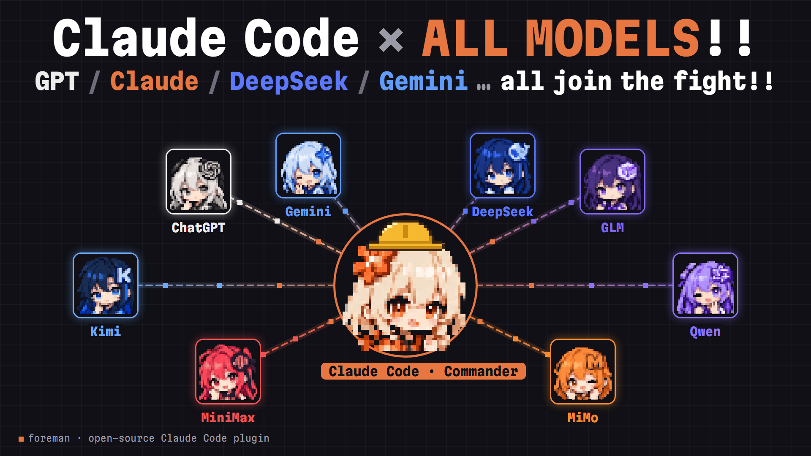
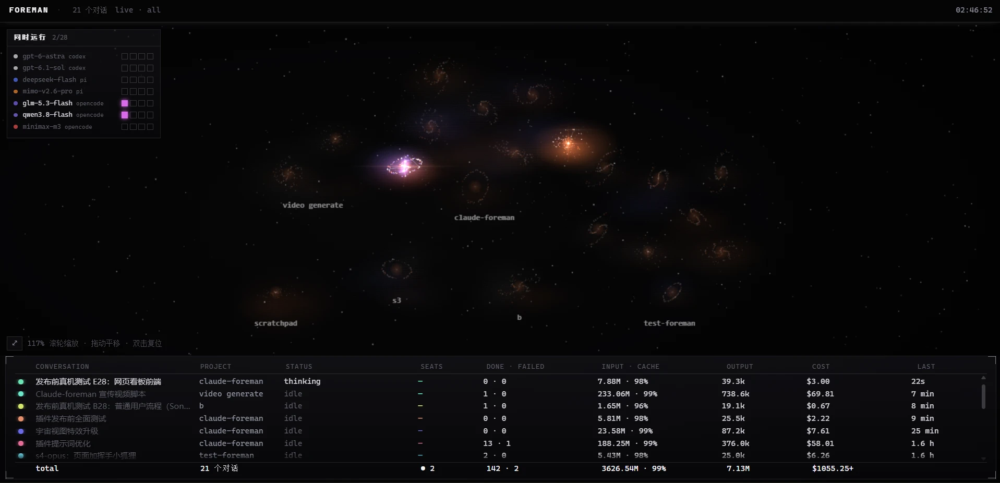
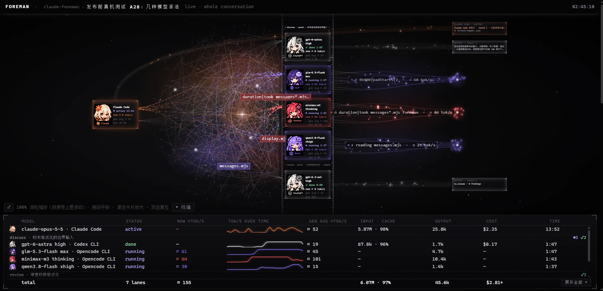
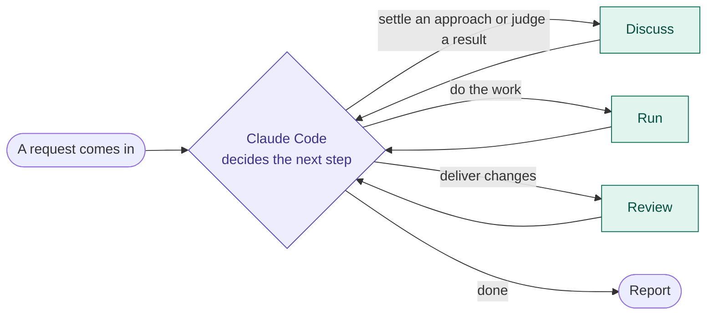
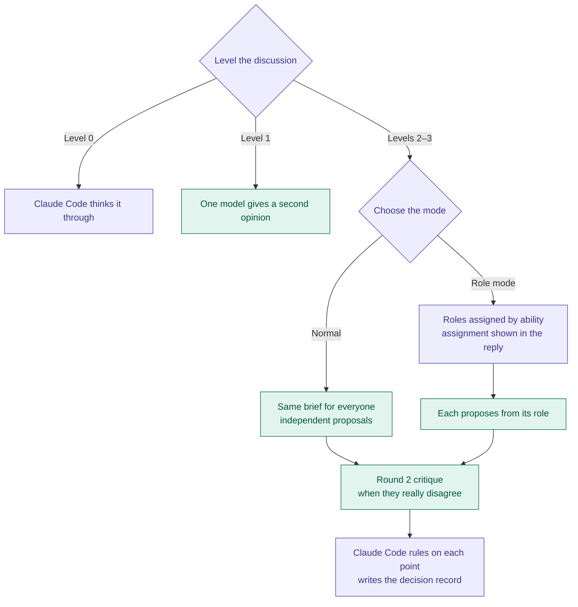
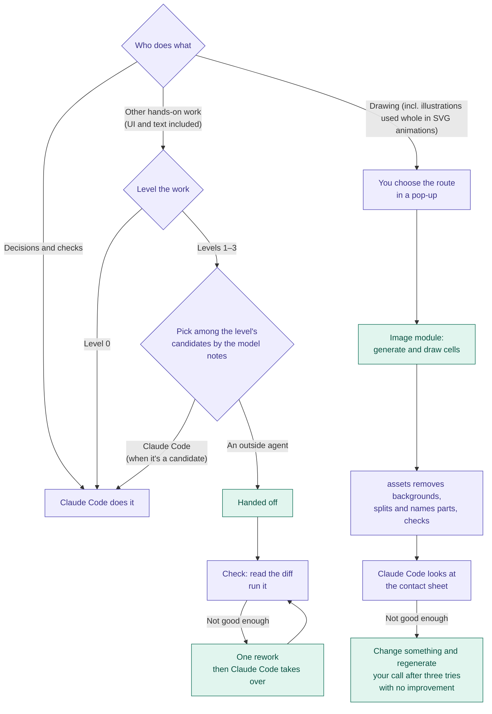
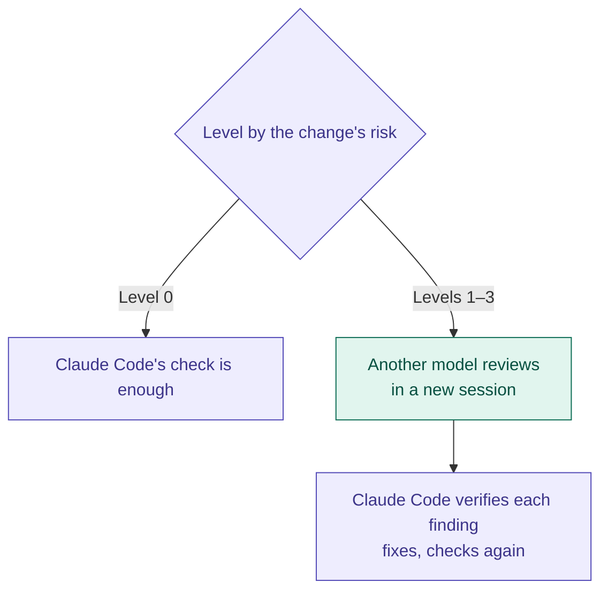

# claude-foreman

[](LICENSE)
[](https://linux.do)
[](https://github.com/DaydayupV/claude-foreman/pulls)
[](https://github.com/DaydayupV/claude-foreman/stargazers)

[中文](README.zh-CN.md)



foreman is a Claude Code plugin that makes Claude Code the foreman of your other AI coding tools. Claude Code still plans the work, makes the decisions and checks every result, while the hands-on coding, second opinions and code reviews go to Codex, opencode, pi, agy, CodeBuddy or any model with an OpenAI-compatible API, as your config says.

- **Claude Code checks the work**: it reads every diff an agent hands back, runs it, and sends it back if it isn't right. In discussions, the other models' views are input; Claude Code weighs each point on its merits.
- **Many models in one conversation**: models from different providers can discuss a design or review a change together, each from its own angle.
- **Your own quota**: agents run on your Codex plan, opencode subscription or API credit, not on your Claude Code allowance.
- **Visible all the way**: every handoff says who got it, with which model and reasoning effort, and you can watch each model work, live.

**Intro video**: [watch on Bilibili](https://www.bilibili.com/video/BV13sxL6aE4Z/)

The web board's star map: each recent conversation on this computer is a galaxy, and the ones handing off work light up.



Inside one conversation: four models discussing at once, with each seat's progress, live speed, output and cost.



## What it's like to use

Once it's installed, you talk to Claude Code the way you always do. There are no commands to learn. For example:

> Add a date filter to the order export, and cover it with tests.

Claude Code breaks the request into steps and, at each one, decides whether another model is worth bringing in:

1. **Settle the approach.** If the way forward is clear, it just starts. If there are real options to weigh and a wrong choice would be costly, it asks a few models for independent proposals, has them critique each other, then decides and tells you which points it took and which it didn't.
2. **Do the work.** It makes small changes itself and hands larger pieces of coding to Codex, opencode, pi, agy or CodeBuddy, as your config says. Every handoff names the model and the reasoning effort, and you can watch the work live in the terminal or on the web board.
3. **Check the result.** It reads every diff that comes back, runs the tests, and sends the work back if it isn't right.
4. **Review before delivery.** When a change carries risk, another model reviews it in a fresh session. Claude Code checks each finding against the code and drops the false positives.

At the end it tells you who did each step, how many tokens they used, and roughly what that would cost at official API prices.



**You stay in control**

- Who takes each level of work, how many models join in and who must take part all live in your config, and `/foreman-en:setup` walks you through it.
- Pause points decide when Claude Code stops to check with you. By default it only asks before acting on the results of a level 3 discussion, or of a review at level 2 or above.
- What you've learned about each model (what it's good at, where it tends to slip) goes in the [model notes](#model-notes), and Claude Code draws on them when it picks an agent, writes the brief and checks the work.

## Install and setup

### In the Claude desktop app (recommended)

foreman is developed and tested mainly in the Code tab of the Claude desktop app, where the live view opens in the terminal panel by itself after each handoff.

1. Download the package from the [latest release](https://github.com/DaydayupV/claude-foreman/releases/latest): `foreman-en.plugin` for English, or `foreman.plugin` for Chinese. Install just one (see [English and Chinese versions](#english-and-chinese-versions)). The `.zip` and `.plugin` files of the same plugin are identical.
2. Upload the file as a plugin in the Claude desktop app. It's listed under "My Uploads".
3. Open the Code tab and run `/foreman-en:setup` (see [Running setup](#running-setup)).

### From the marketplace

In the Claude Code CLI, or in the desktop app if you'd rather not upload a file:

```
/plugin marketplace add DaydayupV/claude-foreman
/plugin install foreman-en@claude-foreman
```

For the Chinese plugin, install `foreman@claude-foreman`. The CLI does the same handoffs, reviews and discussions; the only difference is that you open the live view yourself, in another terminal, with the command Claude Code gives you.

To upgrade later, see [Upgrading](#upgrading).

### Requirements

- [Claude Code](https://claude.com/claude-code)
- Node.js 18 or later. If you run Claude Code inside WSL, install Node.js inside WSL too, or the plugin's hooks will fail before every command.
- Git 2.25 or later, used to track which files an agent changed.
- As many agents as you like. With none, the plugin still works, and Claude Code does everything itself.
  - The [Codex CLI](https://github.com/openai/codex), installed and signed in. Recommended; image generation can only go to Codex.
  - [opencode](https://opencode.ai) 2.x or [pi](https://github.com/earendil-works/pi), to reach models from many providers.
  - Agy CLI (Google Antigravity CLI), installed and signed in. Verified on Windows 11 so far.
  - CodeBuddy CLI (Tencent Cloud's coding assistant), installed and signed in. Verified on Windows 11 with Git for Windows so far.
  - API keys for models with an OpenAI-compatible API, such as DeepSeek, Kimi or MiMo. These join discussions and reviews.

### Running setup

Run `/foreman-en:setup` after installing. It checks this machine and walks you through the config:

- **What it found**: the tools you have, every model they can reach, and the reasoning efforts each model supports.
- **Your current setup**: who takes each level of each kind of work, how many models join, who's required, and anything to watch out for.
- **Suggested changes**, each explained in a sentence or two. On a first run or right after an update, it starts with what's new and whether any of it needs you. You accept the suggestions or adjust them one by one in a pop-up.

It then writes the config, creates or fills in your [model notes](#model-notes), and lists the five files you can edit yourself, with their full paths on your computer (see [Configuration](#configuration)). Run it again whenever you install a new tool or want to change models.

### English and Chinese versions

There are two plugins that differ only in language:

- `foreman-en`: English, with commands like `/foreman-en:setup`
- `foreman`: Chinese, with commands like `/foreman:setup`

Install just one. Both read the same config, preference files, model notes and run records, so you can switch without setting anything up again.

## How it works

### Three modules

foreman works in three modules: **discuss**, **run** (hands-on work) and **review**. They have no fixed order. After each step Claude Code decides what comes next, so one request can go "discuss the approach → run → review", or "run → review → discuss a design problem the review raised → run again".

### Levels

Each time Claude Code enters a module, it gives that step a level by the module's own criteria. Level 0 is small enough that Claude Code handles it itself. Levels 1–3 (`simple`, `normal`, `complex`) go to the candidates you set for that level in the config.

| Level | Discussion: how uncertain, how costly a wrong choice | Hands-on work: how much judgement, how costly a mistake | Review: how risky the change |
|---|---|---|---|
| 0 | The approach is clear, or you've already decided | A small change in one place, quicker to make than to brief | Small changes, docs, styling, config, or low-risk changes covered by tests |
| 1 `simple` | A one-off question that needs a second opinion | The method is settled and needs little judgement | Large but mechanical changes |
| 2 `normal` | A few options to compare, with limited impact | There's a spec, but the details need designing | Larger ordinary features and fixes |
| 3 `complex` | Complex, uncertain and costly to get wrong | Unknown cause, costly mistakes, or changes across modules | Code that touches money, data, concurrency or access control |

Levels go by judgement and risk, not by how much changes: renaming across 20 files from a list is simple, while changing an interface between modules is complex. A review is levelled by what the changed code could affect, and only hand-written code counts toward its size, not docs or generated files.

### Who does what

- **Claude Code always keeps the decisions and the checks**: planning, levelling each step, picking agents, writing briefs, checking results, ruling on discussion and review points, and reporting to you.
- **Hands-on work** at levels 1–3 goes to that level's candidates. A level set to `"claude code"` is done by Claude Code itself, and a candidate list can also include Claude Code alongside outside agents: it then does the work itself only when the [model notes](#model-notes) say its model is better at this kind of work.
- **Discussions and reviews** always include Claude Code's own seat, plus as many outside models as the level asks for.
- **Images** go through a separate image module, where you choose the route before work starts (see [Images](#images)).
- If a required model fails or runs out of quota, the step counts as unfinished. Another model doesn't quietly stand in for it.

<details>
<summary>What happens inside each module</summary>

Purple steps are done by Claude Code; green ones involve an agent.

**Discuss**



**Run**



**Review**



</details>

## Everyday use

### Commands

You never have to use these, but they're there when you want to ask for something by name:

| Command | What it does |
|---|---|
| `/foreman-en:run <task>` | Hands a task to the configured agent, then Claude Code checks the diff, runs it and sends it back for rework if needed |
| `/foreman-en:review` | Has an agent review uncommitted changes, a branch or a commit, existing files, research conclusions with their evidence, or screenshots and playback files. Claude Code checks each finding and drops false positives |
| `/foreman-en:discuss <topic>` | Several models each propose an approach and critique each other's; Claude Code rules on each point and writes a decision record |
| `/foreman-en:watch` | Opens the live view, plus the web board link when the board is on |
| `/foreman-en:status` | Lists recent runs, or shows one in detail, with token use and Codex quota |
| `/foreman-en:setup` | Checks this machine and walks you through the config |
| `/foreman-en:config` | Shows or changes the config |

You can also just ask Claude Code to "check the environment" (whether each agent works and supports the configured efforts, and whether Codex's sandbox starts), to "list the available models", or to "show the model tiers" (each model's tier, overall score, strengths and weaknesses on the LiveBench leaderboard).

### When Claude Code starts things on its own

Without any command, Claude Code levels each step as it comes up and starts what crosses the threshold:

- Before proposing an approach, or when judging a result to decide what to adjust, it talks complex, uncertain questions through with other models first.
- Before doing hands-on work, it hands it off as the level and config say.
- Before delivering changes, it decides by their risk whether another model should review them.
- When a large task splits into parts that don't touch each other, it hands them to several sessions at once (each agent's limit is `max_parallel`).

Every time it does, it tells you in a sentence who it handed the work to and why.

### Pause points

`dispatch.confirm` in your user config decides where Claude Code stops to check with you. The default:

```json
"confirm": {
  "discuss": { "start": "auto", "adopt": "complex" },
  "run":     { "start": "auto" },
  "review":  { "start": "auto", "adopt": "normal" },
  "roles": "auto",
  "image": "ask"
}
```

- `start` is the point before a discussion, a handoff or a review begins; `adopt` is the point after a discussion or review, before Claude Code acts on the results. Each takes `"auto"` (don't ask), `"ask"` (always ask), or a level (`"simple"`, `"normal"` or `"complex"`: ask at that level and above).
- `roles` is the role assignment of a role-mode discussion, and `image` is the image route and final image. Each takes `"ask"` or `"auto"`.
- `"confirm": "ask"` asks at every step, and `"confirm": "auto"` never stops; `/foreman-en:setup` offers these as presets.
- Things you ask for by name aren't asked about again before they start, and level 0 work never is.
- When nobody can answer (in an unattended run, for example), the start and adopt points go ahead without asking, and the report says so.
- Only the user config counts here, so a repository you clone can't use its project config to skip your confirmations.

### Role-mode discussions

When a topic has goals pulling against each other (security and convenience, cost and user experience, compatibility and a rewrite), a level 2 or 3 discussion can use role mode. Each model gets a role card and examines the same topic from one angle, such as architect, correctness, fact checker, security, maintenance and compatibility, user experience or edge cases, often alongside an overall reviewer with no role.

- Roles are assigned by ability: first whether the model's tools can do the job (only Codex can run commands, so only Codex can be the fact checker), then its strengths and tier. Hard roles go to strong models first, and weaker ones can join as breadth seats.
- The angles a topic needs most each get their own seat.
- By default Claude Code shows the "model → role" assignment in its reply and starts; set `dispatch.confirm.roles` to `"ask"` to approve it in a pop-up first.
- A role only shapes what a model looks at most closely. Conclusions still go by evidence, and several roles agreeing doesn't count as extra evidence.

Custom roles go in your [preference files](#preference-files); the full role table is in [references/roles.md](foreman-en/skills/dispatch/references/roles.md).

### Images

Codex draws the images, and Claude Code turns them into assets you can use straight away: transparent PNG parts, a manifest listing them by name, a contact sheet, and SVG for flat graphics with few colours.

- **You choose the route first.** Before each new graphic, a pop-up asks how to make it: ① bitmap, ② bitmap plus hand-drawn vector pieces that bend, ③ pure vector from a reference image, or ④ pure vector or code, with no image generation. It also says which model generates, which hand-draws, and whether your reference images get uploaded.
- **One final image, approved by you.** For animations and SVG, Codex draws a single final image, and nothing goes further until you've approved it. Every piece is then cut or traced from that image, so the parts line up exactly.
- **Checked before delivery.** Claude Code looks at the contact sheet, takes screenshots, and plays animations through once to check for flicker.
- **Not supported**: pixel art, exact pixel sizes, images above about 1.57 megapixels, and big turns or changes of viewpoint.

With `dispatch.confirm.image` set to `"auto"`, Claude Code picks the route from your request (or the recommended one), explains it in its reply and starts. The workflow is in [references/image.md](foreman-en/skills/dispatch/references/image.md), and the `assets` commands in [references/assets-cli.md](foreman-en/skills/dispatch/references/assets-cli.md).

## Watching the work

### The live view

In the Claude desktop app, the live view opens in the terminal panel by itself after each handoff (unless the web board is on). In the CLI, Claude Code gives you the command to run in another terminal, and `/foreman-en:watch` opens it any time.

- **Each run** starts with two lines: the model, its effort and how it's reached (such as "gpt-6.1-sol max · Codex CLI") with the status and elapsed time, then the task (module, title, level). Below them is a timeline of what the model says, the commands it runs, the files it reads and changes, and the images it makes. A failed command is marked at the end of its line.
- **Discussions, reviews and split work** share one window, one block per seat, with Claude Code's own seat first. Press a seat's number to open its full timeline, and Esc to go back.
- **Keys**: ↑↓, PgUp/PgDn or the mouse wheel to scroll, End to jump to the latest, q to stop watching (the run keeps going), n to follow a run that was resumed, and x to stop an API seat that's queued because its service is busy.
- **Colour means status**: cyan running, green done, yellow waiting or queued, red anything that didn't finish.
- When a run ends, the view stays on screen with the duration, changes, token use and cost. Add `--verbose` for every detail, including raw reasoning and command output.
- The first time it opens for a new conversation, a few seconds of intro play (the model's pixel avatar and a joke or two). Any key skips it, and `dispatch.intro: false` turns it off.

The full layout is described in [references/watch.md](foreman-en/skills/dispatch/references/watch.md).

### The web board

The web board is a second way to watch, in your browser. It's off by default: turn it on with `dispatch.watch.web: true`, or let `/foreman-en:setup` decide from this computer's memory. While it's on, every handoff gives you a board link instead of opening the terminal view; set `dispatch.watch.web_open: true` to have it open in your default browser on a conversation's first handoff.

- **The star map**: every Claude Code conversation on this computer from the last 24 hours is a galaxy, and conversations from the same project gather into a nebula, coloured by the models they used. Agents at work circle their galaxy; a conversation waiting for you gets an amber ring, and one with a failure a red dot. The table below lists each conversation with its runs, tokens and cost; click a row or a galaxy to fly in.
- **One conversation's board**: cards for Claude Code and each seat, with animations for the plan, the cross-check and the verdict, a usage table, and each seat's terminal. It covers the conversation's whole history. Esc takes you back to the star map.
- **Cost** is always priced at each model's official API price, so you can compare models. It can differ from what you're actually charged: Codex and Claude Code subscriptions aren't billed per token, and opencode and pi bill through their own accounts. A model with no known price shows `?`.
- **The board server** is one local process shared by every conversation, reachable only on 127.0.0.1 with a random token in the address. It only reads your conversation and run records, and stops after 30 minutes with nobody watching and nothing running. When it starts again it keeps the same address, so earlier links still work.
- **Treat board links like a password**: anyone on this computer with a link can open the board while it runs. To get a new address, stop the server with `node <the plugin's scripts folder>/cli.mjs board --stop` and delete `board.address.json` in the runs folder.
- It needs a recent browser (Chrome or Edge 111, Firefox 113, Safari 16.2 or later) and about 200 MB of memory between the server and the tab; on a computer low on memory, `/foreman-en:setup` suggests keeping it off.

Replaying a finished conversation for debugging is described under `board` in [references/cli.md](foreman-en/skills/dispatch/references/cli.md).

## Agents

| `type` | What it is | What it can do | Reads your code itself | How it's kept in bounds | Whose quota |
|---|---|---|---|---|---|
| `codex cli` | The Codex CLI | Hands-on work, discussions, reviews, images | Yes | Codex's own sandbox | Your Codex plan or OpenAI API |
| `opencode cli` | opencode, with any model it can reach | Discussions and reviews; hands-on work once you allow it | Yes | Only the tools the task needs, plus write rules; no OS sandbox | Providers you've signed in to in opencode, or an OpenCode Go subscription |
| `pi cli` | pi, with any model it can reach | Same as opencode | Yes | Only the tools the task needs, plus a guard that keeps file access in the project; no OS sandbox | Providers you've signed in to in pi |
| `agy cli` | Agy CLI (Google Antigravity CLI) | Discussions and reviews; hands-on work once you allow it | Yes | A guard in agy's global hooks checks every tool call | The Google account you signed in to in agy |
| `codebuddy cli` | CodeBuddy CLI (Tencent Cloud) | Discussions and reviews; hands-on work once you allow it | Yes | A guard hook keeps reads and writes in the project | The Tencent Cloud account you signed in to in CodeBuddy |
| `api` | Any model with an OpenAI-compatible API | Discussions and reviews | No; Claude Code attaches the relevant files | Not applicable | The provider's API balance |

You can have several agents of one type, each with a different model, and Codex isn't required. Codex, opencode, agy and CodeBuddy can look things up on the web in discussions and hands-on work (never in reviews); pi and API models can't.

### Codex

Install the [Codex CLI](https://github.com/openai/codex) and sign in. It's the recommended agent: it can do every kind of task, and it's the only one that generates images.

- Codex works inside its own sandbox, set per task type with `sandbox` (`read-only`, `workspace-write` or `danger-full-access`); left out, your Codex config applies. `read-only` is recommended for discussions and reviews.
- On Windows, Codex's default sandbox needs a one-time setup with administrator rights, and if that setup is broken every command fails. Ask Claude Code to "check the environment": it tests the sandbox without calling a model and suggests the fix, usually `[windows] sandbox = "unelevated"` in your Codex config.
- For web search, Codex follows your `~/.codex/config.toml`. If it doesn't set `web_search`, the plugin turns on live search for discussions and hands-on work.
- Leave `approval` at the default `never`: nobody can approve a prompt inside a handed-off task.

### API models

Any model with an OpenAI-compatible API (DeepSeek, Kimi, MiMo, GLM, Qwen, OpenRouter and so on) can join discussions and reviews.

1. **Add the agent**: `{ "type": "api", "base_url": "...", "model": "..." }`. Provider-specific parameters go in `extra_body`.
2. **Add the key**, one of two ways:
   - an environment variable, with `"api_key_env": "DEEPSEEK_API_KEY"` (restart Claude Code after setting it), or
   - the config itself, with `"api_key": "sk-..."`. It's stored in plain text, so don't commit or share the file.
3. **Add it to the cells** you want under `modules`.

Or just ask: `/foreman-en:setup add DeepSeek`. You type the key in yourself; there's no need to paste it into the chat. API models can't browse your code, so Claude Code sends the relevant files with the brief (the patch, for a review) and checks what they say against the source.

### opencode

With opencode 2.x, any model it can use can take part, such as GLM, Kimi, Qwen, MiniMax or DeepSeek through an [OpenCode Go](https://opencode.ai/docs/go/) subscription. These models read your project themselves, and every file they read is another request against your quota.

1. **Sign in**: run `opencode`, sign in with `/connect`, then run `opencode models` to see what you can use. Skip the free models (names ending in `-free`): opencode only allows them inside its own app.
2. **Add them**: one entry per model, such as `{ "type": "opencode cli", "model": "opencode-go/glm-5.3" }`, then list it in the cells you want.

In discussions and reviews, opencode gets a read-only agent with tools to read, search and list files. In discussions and hands-on work it can also read web pages, and search the web once you've set up a search provider in opencode (`"websearch": {"provider": "random"}`, or a provider you name). Your keys and sign-in stay in opencode. OpenCode Go's limits are per model, and premium models have small ones, so keep those for complex discussions.

### pi

Install pi with `npm install -g @earendil-works/pi-coding-agent`. It works like opencode.

1. **Sign in**: run `pi`, sign in to the providers you want with `/login` (or set their API key environment variables), then run `pi --list-models`.
2. **Add them**: one entry per model, such as `{ "type": "pi cli", "model": "deepseek/deepseek-flash" }`.

- The effort is pi's thinking level (`off` to `max`). If a model doesn't support the level you set, pi quietly uses the nearest one instead of reporting an error, so ask Claude Code to check the environment after a change: it tells you which level would really be used.
- Each call enables only the tools the task needs, and a guard extension keeps file access inside the project. Your own extensions, skills and MCP servers aren't loaded.

### CodeBuddy

Install the CodeBuddy CLI with `npm install -g @tencent-ai/codebuddy-code` (the command is `codebuddy` or `cbc`) and sign in. Verified on Windows 11 so far, where Git for Windows is required.

1. **Sign in**: run `codebuddy`, sign in with `/login`, then run `codebuddy --help` and look at the models under "Currently supported".
2. **Add them**: one entry per model, such as `{ "type": "codebuddy cli", "model": "deepseek-v4.1-flash" }`. Add `"run_access"` if you want it to do hands-on work (see [Letting agents change files](#letting-agents-change-files)).

- Every call goes through a guard hook the plugin injects: reads and writes stay inside the project, and `.git`, `.codebuddy` and `.claude` can't be changed. In discussions and hands-on work it can also search the web and read web pages.
- To keep those limits from being loosened, a call is refused when your CodeBuddy user settings contain `permissions.allow`, `additionalDirectories`, `hooks` or enabled plugins, and the message names the settings file. Project settings and MCP servers aren't loaded.
- The effort ranges from `minimal` to `max`.

### agy

Agy CLI (Google Antigravity CLI, command `agy`) can join discussions and reviews, and do hands-on work once you allow it. Verified on Windows 11 so far.

1. **Install the guard.** agy can't load a plugin per call, so foreman controls its tools through a guard in agy's global hooks. When `/foreman-en:setup` adds agy, it asks for your consent first, then installs the guard under `~/.gemini/config/` (backing up your existing `hooks.json`). After a plugin update, the guard updates itself the next time agy is used; there's nothing to reinstall.
2. **Add the models.** Run `agy models` to see what you can use. agy puts the effort at the end of the model ID (`gemini-3.8-flash-high`); in foreman you write the model and the effort separately, `{ "type": "agy cli", "model": "gemini-3.8-flash" }` with `"effort": "high"` in the cell.

- **Your own agy use**: when foreman isn't running agy, the guard lets agy behave exactly as before (it adds about 0.1 s per tool call). While foreman runs agy in a folder, your own agy in that same folder has its tool calls paused, with a message saying why and until when.
- **Discussions and reviews** can only read files, inside the project and folders you add with `--add-dir`. Where agy's sandbox passes the plugin's test, agy also gets a shell for read-only commands; on Windows it doesn't for now, because agy's sandbox there can read folders outside your user folder.
- **Web and browser**: in discussions and hands-on work, agy can search the web. Its browser subagent is allowed too: it drives your own Chrome through Chrome's remote debugging, so it acts with your sign-ins, and it only connects once you turn on remote debugging at `chrome://inspect/#remote-debugging`. It can read your open tabs and act on websites, local services and intranet systems as you. None of this is allowed in reviews.
- **When agy isn't used**: if the project has its own agy hooks, MCP or plugin config, or your global `hooks.json` has other hooks, foreman can't vouch for them, so it doesn't use agy that time and names the file that stopped it.
- **Uninstalling the guard**: ask Claude Code to run `agy-guard uninstall`. If the plugin is already gone, delete the `foreman-guard` entry from `~/.gemini/config/hooks.json`, then delete `foreman-agy-guard.mjs`, `foreman-agy-guard.cmd` and `foreman-agy-guard.sh` in the same folder. Deleting the files but not the entry blocks every agy tool call.

### Letting agents change files

Codex does hands-on work out of the box. opencode, pi, agy and CodeBuddy only do it once you give them `run_access` in your user config and list them in a `run` cell (or the image `draw` cell); a project config can't turn this on.

- `"edit"`: reads and writes files in the project, with no commands. Claude Code runs the tests afterwards.
- `"shell"`: can also run commands, such as tests. There's no OS sandbox, so its commands run with your account's permissions and can reach the whole machine. Use it only for projects and models you trust.

Either way, foreman takes a snapshot first, and Claude Code reviews the diff file by file afterwards. Writes are held to the project in every case:

- **None of them** can write outside the project.
- **opencode, agy and CodeBuddy** also keep out of the folders that hold git's, Claude Code's and the agents' own config and hooks (`.git`, `.claude`, `.opencode`, `.codebuddy`, `.gemini`, `.agents` and the like), since a file written there could run commands later.
- **opencode** also can't write through links in the project (to change the file a link points to, it uses the real path), or into the folders git actually uses and worktrees registered in the project. At `edit` it doesn't run the project's formatter commands either. These rules haven't been tested on macOS or Linux yet.
- **agy** treats folders added with `--add-dir` as read-only, and won't take hands-on work when the project contains, or sits inside, the `.gemini` or `.claude` folder in your home folder, foreman's state folder or the run records.
- **CodeBuddy** won't take `edit` work while your CodeBuddy user settings have `permissions.deny` or `permissions.ask` rules.

The complete rules for each agent are in [references/config.md](foreman-en/skills/dispatch/references/config.md).

## Configuration

There are five files you can edit yourself. `/foreman-en:setup` ends by listing their full paths on your computer.

| File | Where | What it controls | When a change takes effect |
|---|---|---|---|
| User config | `~/.claude/foreman/config.json` | Your agents; who takes each level of each kind of work, how many models join and who's required; switches such as pause points and the web board | From the next handoff or command |
| Project config | `<project>/.claude/foreman.json` | This project only: overrides cells and time limits, see [Project config](#project-config) | Same as above |
| User preferences | `~/.claude/foreman/preferences.md` | How you'd like things done, in your own words, plus scene routing, see [Preference files](#preference-files) | When a new session starts, or after you ask Claude Code to read it again |
| Project preferences | `<project>/.claude/foreman.md` | This project only; wins over the user preferences where they conflict | Same as above |
| Model notes | `~/.claude/foreman/models.md` | What each model is good and bad at, see [Model notes](#model-notes) | Same as above |

If the `FOREMAN_CONFIG` environment variable points to another user config, the user preferences and model notes live next to that file. You can edit any of them directly, or tell Claude Code something like "use `/foreman-en:config` to switch complex tasks to ultra". Every setting is documented in [references/config.md](foreman-en/skills/dispatch/references/config.md).

### How the config is laid out

| Part | What it covers |
|---|---|
| `dispatch` | How foreman hands work off: pause points, the live view and web board, discussion rounds, time limits, where run records go |
| `agents` | Which agents you have and how to reach them |
| `modules` | For each kind of work and each level: the candidates, who's required, which effort, and for discussions and reviews how many seats |

A minimal example: Codex does complex hands-on work and every review, complex discussions add one model from opencode, and Codex also generates images and hand-draws pieces. Anything left out uses its default.

```json
{
  "agents": {
    "gpt-6.1-sol": { "type": "codex cli", "model": "gpt-6.1-sol" },
    "gpt-6-astra": { "type": "codex cli", "model": "gpt-6-astra" },
    "glm-5.3":     { "type": "opencode cli", "model": "opencode-go/glm-5.3" }
  },
  "modules": {
    "default": {
      "discuss": { "simple": "claude code", "normal": [{ "agent": "gpt-6.1-sol", "effort": "high" }], "complex": [{ "agent": "gpt-6-astra", "effort": "max", "required": true }, { "agent": "glm-5.3" }] },
      "run":     { "simple": "claude code", "normal": "claude code", "complex": [{ "agent": "gpt-6.1-sol", "effort": "max" }] },
      "review":  { "simple": [{ "agent": "gpt-6.1-sol", "effort": "medium" }], "normal": [{ "agent": "gpt-6.1-sol", "effort": "high" }], "complex": [{ "agent": "gpt-6-astra", "effort": "max" }] },
      "image":   { "generate": [{ "agent": "gpt-6.1-sol", "effort": "medium" }], "draw": [{ "agent": "gpt-6-astra", "effort": "max" }] }
    }
  }
}
```

- **Agent IDs**: each key under `agents` is an ID that `modules` refers to. Naming it after its model reads best.
- **Cells**: `discuss`, `run` and `review` each have three levels; `image` has two cells instead, `generate` and `draw`. A cell lists candidates. An entry with `"required": true` always takes part when the cell is used.
- **Seats**: for discussions and reviews, `seats` sets how many outside models each level uses (Claude Code's own seat isn't counted), and `gap` adds one more reviewer at the end that only looks for what the others missed. Hands-on work goes to one agent per piece of work.
- **Claude Code itself**: `"claude code"` as a cell means Claude Code does that level itself, with no outside model. In a `run` cell you can also list it as one candidate among others, `[{ "agent": "claude code" }, { "agent": "gpt-6.1-sol", "effort": "high" }]`, and Claude Code then takes the work only when the [model notes](#model-notes) say its model is better at that kind of work. `null` turns an image cell off.
- **Effort**: `effort` is the reasoning effort, left out for the default. For Codex it's `low` to `ultra`; for opencode, the model's variant; for pi, its thinking level; for agy and CodeBuddy, a level such as `high`; for API models it's sent as `reasoning_effort`.

<details>
<summary>A complete example using several kinds of agents</summary>

```json
{
  "dispatch": {
    "confirm": {
      "discuss": { "start": "auto", "adopt": "complex" },
      "run": { "start": "auto" },
      "review": { "start": "auto", "adopt": "normal" },
      "roles": "auto",
      "image": "ask"
    },
    "watch": { "terminal": true, "web": false },
    "intro": true,
    "discuss_max_rounds": 2,
    "timeout_min": 240,
    "stall_min": 20,
    "busy_ask_min": 2
  },
  "agents": {
    "gpt-6-astra":        { "type": "codex cli", "model": "gpt-6-astra" },
    "gpt-6.1-sol":        { "type": "codex cli", "model": "gpt-6.1-sol" },
    "deepseek-flash":     { "type": "opencode cli", "model": "deepseek/deepseek-flash" },
    "glm-5.3":            { "type": "opencode cli", "model": "opencode-go/glm-5.3" },
    "mimo-v2.6-pro":      { "type": "pi cli", "model": "xiaomi/mimo-v2.6-pro" },
    "kimi-k2.6":          { "type": "api", "base_url": "https://api.moonshot.cn/v1", "api_key_env": "KIMI_API_KEY", "model": "kimi-k2.6" }
  },
  "modules": {
    "default": {
      "discuss": {
        "simple": [
          { "agent": "gpt-6-astra", "effort": "medium" },
          { "agent": "glm-5.3" }
        ],
        "normal": [
          { "agent": "gpt-6-astra", "effort": "high" },
          { "agent": "deepseek-flash", "effort": "high" },
          { "agent": "glm-5.3" }
        ],
        "complex": [
          { "agent": "gpt-6-astra", "effort": "max", "required": true },
          { "agent": "deepseek-flash", "effort": "max" },
          { "agent": "kimi-k2.6" },
          { "agent": "mimo-v2.6-pro", "effort": "high" },
          { "agent": "glm-5.3" }
        ],
        "seats": { "simple": 2, "normal": 4, "complex": 8 }
      },
      "run": {
        "simple":  "claude code",
        "normal":  "claude code",
        "complex": [{ "agent": "claude code" }, { "agent": "gpt-6.1-sol", "effort": "max" }]
      },
      "review": {
        "simple":  [{ "agent": "gpt-6-astra", "effort": "medium" }],
        "normal":  [{ "agent": "gpt-6-astra", "effort": "high" }, { "agent": "deepseek-flash", "effort": "high" }],
        "complex": [{ "agent": "gpt-6-astra", "effort": "max", "required": true }, { "agent": "deepseek-flash", "effort": "max" }, { "agent": "glm-5.3" }],
        "seats":   { "simple": 1, "normal": 2, "complex": 2 },
        "gap":     { "simple": false, "normal": false, "complex": true }
      },
      "image": {
        "generate": [{ "agent": "gpt-6.1-sol", "effort": "medium" }],
        "draw":     [{ "agent": "gpt-6-astra", "effort": "max" }]
      }
    }
  }
}
```

Claude Code does simple and normal hands-on work itself. Complex hands-on work goes either to Claude Code or to `gpt-6.1-sol`, depending on what the model notes say each is better at. Discussions and reviews get more candidates as the level rises; `gpt-6-astra` is required at the complex level, and complex reviews add a gap seat.

Other agent settings you may want:

```json
"gpt-6.1-sol":     { "type": "codex cli", "model": "gpt-6.1-sol", "sandbox": { "discuss": "read-only", "review": "read-only" }, "max_parallel": 2 },
"glm-5.3":         { "type": "opencode cli", "model": "opencode-go/glm-5.3", "run_access": "edit" },
"deepseek-v4-pro": { "type": "api", "base_url": "https://api.deepseek.com", "api_key_env": "DEEPSEEK_API_KEY", "model": "deepseek-v4-pro", "extra_body": { "temperature": 0.3 } }
```

- `sandbox`: Codex's sandbox per task type (`run`, `review`, `discuss`).
- `max_parallel`: how many runs this agent may have going at once (4 by default, 2 for agy). Extra handoffs queue for a free slot.
- `run_access`: lets opencode, pi, agy or CodeBuddy change files, see [Letting agents change files](#letting-agents-change-files).
- `extra_body`: extra parameters for API requests.
- `bin`: the full path to the program, if foreman can't find it.

</details>

### Project config

When one project needs different candidates, more or fewer models, or longer time limits, put a `.claude/foreman.json` in it:

```json
{
  "dispatch": { "timeout_min": 600 },
  "modules": {
    "default": {
      "review": {
        "normal": [{ "agent": "gpt-6.1-sol", "required": true }, { "agent": "glm-5.3" }, { "agent": "kimi-k2.6" }],
        "seats": { "normal": 3 }
      }
    }
  }
}
```

- It can only set `modules` and four settings under `dispatch` (`discuss_max_rounds`, `timeout_min`, `stall_min`, `busy_ask_min`). Agents, pause points and the web board belong to the user config, and a project can't add agents of its own.
- A cell it sets replaces the user config's cell as a whole; cells it doesn't set keep your values.

### Configuring by scene

The same kind of task sometimes needs a different setup. A review of research evidence should be broad, with more providers and a gap seat; a review of high-risk code should be precise, with only the two strongest models at full effort. For that, `modules` can hold a setup per scene: `default`, plus scenes that list only what they change. If you don't need this, keep just `modules.default`.

First describe the scenes in a preference file (`/foreman-en:setup` can write this for you):

```markdown
<!-- foreman:scenes -->
## Scene routing
- **code**: judging or deciding changes to code, interfaces, configs, scripts and tests; reviews with `--target diff` always count as code.
- **research**: research conclusions and evidence, research plans, research reports, research-direction ideas; reviews with `--target claims` always count as research.
- Split work that has both into two plans; use default where nothing here applies.
<!-- /foreman:scenes -->
```

Then add the scene blocks under `modules`:

```json
"modules": {
  "default": { "discuss": { … }, "run": { … }, "review": { … }, "image": { … } },
  "code": {
    "review": { "complex": [{ "agent": "gpt-6.1-sol", "effort": "max", "required": true }, { "agent": "gpt-6-astra", "effort": "max" }],
                "seats": { "complex": 2 }, "gap": { "complex": false } }
  },
  "research": {
    "review": { "normal": [{ "agent": "gpt-6.1-sol", "effort": "high", "required": true }, { "agent": "gpt-6-astra", "effort": "high" },
                           { "agent": "deepseek-flash" }, { "agent": "glm-5.3" }],
                "seats": { "normal": 3 }, "gap": { "normal": true } }
  }
}
```

Claude Code picks the scene from your routing each time it hands out work, and says which line it followed. Cells a scene doesn't set follow `default`. Details are under "Scenes" in [references/config.md](foreman-en/skills/dispatch/references/config.md).

### Preference files

Some habits don't fit in JSON: which code in your project counts as high-risk, or what you never want handed off. Write them in plain words:

- for all projects: `~/.claude/foreman/preferences.md`
- for one project: `<project>/.claude/foreman.md` (wins where the two conflict)

```markdown
# foreman preferences

- Treat billing and reconciliation code in this project as high-risk: hand it off as complex, and always have Codex review the changes.
- Don't hand off database migration scripts; Claude Code writes them.
- Ask Codex for a review when a change is over 200 lines.
- Use role mode for discussions where performance and maintainability pull against each other.
```

Preferences can change how things are done, but not the plugin's hard rules: required agents, which providers may receive your code, read-only discussions and reviews, the confirmations that need a pop-up, and each level's seat count stay as configured. Custom roles for role-mode discussions also go here (see "Custom roles" in [references/roles.md](foreman-en/skills/dispatch/references/roles.md)).

### Model notes

`~/.claude/foreman/models.md` is where you write what you've learned about each model. `/foreman-en:setup` creates it with a section for each model you use: a line with its LiveBench tier, strengths and weaknesses, then "Strengths" and "Weaknesses" lines. For the GPT Astra and Sol, Gemini 4 and Claude Opus families those lines start out with the plugin's own judgments, marked "plugin default" (GPT, for example, is strong at backend programming but codes defensively and writes stiff prose); for other models they're left for you. When Claude is the host, its section's strengths also carry the plugin's former fixed split of the work: UI and visual design sign-off and text people read. Change or delete any of it where your experience differs. Later setup runs only add sections for new models; they never change what you wrote.

```markdown
## gpt-6-astra
- LiveBench (…): strong tier; …
- Strengths: back end, concurrency and data migrations
- Weaknesses: codes defensively, likes adding fallbacks, compatibility branches and validation

## claude-opus, claude-fable
- Strengths: UI and visual design sign-off, text people read

## kimi-k2.6
- Strengths: treat it as a strong model
```

- **Headings are model names**, without how the model is reached, so one section covers a model whichever tool runs it. A heading can be part of a name and leave the version out: `claude-opus` fits Opus 5.5 and 4.8, and `deepseek-flash` fits deepseek-v4.1-flash. Several models can share a section, separated by commas. When several sections fit one model, all are read, and the more specific one wins where they disagree.
- **How Claude Code uses them**: when a cell has several candidates, it picks by strengths and weaknesses; it turns the chosen model's weaknesses into concrete reminders in the brief (such as "add fallbacks only where the brief asks" for a model that codes defensively); it looks hardest at those weak spots when checking the result; and it weighs review and discussion points with each model's habits in mind.
- **They're input, not verdicts**: whether a point holds is still checked against the code and the evidence. Where your notes and the LiveBench tiers disagree, your notes win. When Claude Code sees a model make the same kind of mistake again and again, it suggests adding a line.

The matching rules are under "The model notes" in [references/config.md](foreman-en/skills/dispatch/references/config.md).

## Safety and privacy

- **Your code goes to the providers behind your agents.** Codex sends it to OpenAI; opencode, pi and API models to the providers you use through them; agy to Google; CodeBuddy to Tencent Cloud. API models also receive the files Claude Code attaches. For a sensitive project, remove those candidates in its project config, or set its discussions and reviews to `"claude code"`.
- **Discussions and reviews are read-only.** They can read your project but not change it: Codex through its read-only sandbox when you set one, the others through the tools they're given. If a discussion or review run writes to the project anyway, the run is marked failed.
- **Hands-on work has limits you choose.** Codex works inside its sandbox. With `danger-full-access` it can reach any folder on your machine; the brief says what to touch and Claude Code reviews the diff, but that isn't isolation, so use `workspace-write` if you want it held to the project. opencode, pi, agy and CodeBuddy have no OS sandbox: at `edit` they can't write outside the project or run commands, while at `shell` their commands can reach the whole machine. Only you can allow them, in the user config.
- **Agents can go online in discussions and hands-on work**, never in reviews. agy's browser subagent drives your own Chrome with your sign-ins once you turn on remote debugging.
- **Claude Code only calls agents through foreman.** A hook stops Claude Code from running `codex exec`, `codex review`, `opencode run`, pi tasks or agy model runs directly, so every call is recorded, has its changes tracked, and uses an explicit model and effort. Running these tools yourself in a terminal isn't affected.
- **Check unfamiliar repositories.** A project's `.claude/foreman.json` can add candidates (only agents you've defined), raise seat counts and lengthen time limits, and its `.claude/foreman.md` can change scene routing. It can't let an agent change files, skip your pause points or carry API keys. Look at both files in a repository you didn't write; Claude Code can show you what they override.
- **API keys** can live in environment variables or in the user config. In the config they're plain text, so don't commit or share `~/.claude/foreman/config.json`. foreman never shows keys and never writes them into run records.
- **Pay-as-you-go costs real money.** Codex on API-key billing, API models and pay-as-you-go providers through opencode or pi are billed for every handoff, discussion and review. Set the `start` pause points to `"ask"` to approve each one first.
- **Agents never sit waiting for an answer.** Whatever they need to know comes back in their result. Claude Code answers within the authority you've already given and resumes the work; it only asks you about business trade-offs, a wider scope, extra cost or steps that can't be undone.

## Run records and stats

Every handoff is recorded in `~/.claude/foreman/runs/<run_id>/`: the brief, the event stream, the changes and the final report. `/foreman-en:status` reads them.

- **Change tracking** uses a separate git repository inside the record folder, never your project's `.git`. It compares the whole working directory before and after a run, so it also notices files that you or another session changed meanwhile; those are marked as being of unknown origin, and Claude Code won't simply revert them. Paths ignored by `.gitignore` aren't tracked unless you ask for them with `--track`.
- **Quota**: when Codex's quota runs out or an API balance is too low, the run is marked `quota_exhausted` and isn't retried; for Codex it includes the expected reset time.
- **Interrupted runs** (the dispatcher exited, got stuck or timed out) are pointed out to Claude Code the next time you open a session in that project.
- **Stats**: ask Claude Code for the stats (`cli.mjs stats`) to see, per model and module, how many points were confirmed or turned out to be false positives, which points only that model found, the rework rate, time, token use and cost. Split them by effort, level or scene, or look only at recent runs. These figures are a good basis for your [model notes](#model-notes).

## Platforms

foreman is developed and tested mainly in the Claude desktop app on Windows (including the Microsoft Store version), and also tested in the CLI. The macOS and Linux code paths are written but not yet tested in practice; issue reports are welcome.

- **The desktop app's terminal panel** only accepts ASCII commands. If your run records folder has non-English characters in its path (a Chinese Windows user name, for example), `/foreman-en:setup` points it out; set `dispatch.runs_dir` to a plain-English path. The CLI isn't affected.
- **Apps started from a desktop** (such as the macOS desktop app) may have a PATH without Homebrew, nvm and similar folders. foreman also looks in common places such as `/opt/homebrew/bin` and `/usr/local/bin`; if a command still can't be found, set `bin` on that agent. The hooks run `node`, so it must be on the PATH too.
- **The live view** redraws the whole screen, which Windows Terminal, macOS Terminal, iTerm2, the VS Code terminal and common Linux terminals all support; very simple terminals (`TERM=dumb`) get line-by-line output instead. If the intro looks wrong in your terminal, turn it off with `dispatch.intro: false`.

## Upgrading

- **Desktop app**: download the new release and upload it the same way, then delete the old version under "My Uploads". A new upload can sit next to the old one instead of replacing it.
- **Marketplace**: run `/plugin marketplace update claude-foreman`.
- **If you have both the English and Chinese plugins**, upgrade both: an older version can't read config written by a newer one, such as Claude Code listed among `run` candidates or the newer pause points.
- **Older configs keep working.** foreman rewrites older config layouts into the current one the first time it reads them, keeping every agent, effort and order, and backs up the original as `config.json.bak`. `/foreman-en:setup` also offers to tidy up what's left over, such as moving per-project settings into each project's own file.
- **The agy guard** updates itself after an upgrade; there's nothing to reinstall.

### Upgrading from codex-bridge

This plugin used to be called codex-bridge. Claude Code doesn't move a plugin to a new name on its own, so switch over once by hand:

1. Uninstall the old plugin: `/plugin uninstall codex-bridge-en@claude-codex-bridge`. With both installed, their hooks block and remind twice.
2. Install `foreman-en` as described in [Install and setup](#install-and-setup).
3. If you installed the old plugin through "My Uploads" in the desktop app, delete it there.

Your settings move over by themselves the first time the new plugin runs:

| Before | Now |
|---|---|
| Plugins `codex-bridge` / `codex-bridge-en`, marketplace `claude-codex-bridge` | `foreman` / `foreman-en`, marketplace `claude-foreman` |
| `/codex-bridge-en:rescue` | `/foreman-en:run`; other commands only change their prefix |
| Config `~/.claude/codex-bridge.json` | `~/.claude/foreman/config.json` (copied) |
| Preferences `~/.claude/codex-bridge.md` | `~/.claude/foreman/preferences.md` (copied) |
| Run records `~/.claude/codex-runs` | `~/.claude/foreman/runs` (moved once no runs are in progress there) |
| A project's `.claude/codex-bridge.json` and `.claude/codex-bridge.md` | `.claude/foreman.json` and `.claude/foreman.md` (the old names are still read) |
| Environment variables `CODEX_BRIDGE_CONFIG`, `CODEX_RUNS_DIR`, `CODEX_BRIDGE_LANG` | `FOREMAN_CONFIG`, `FOREMAN_RUNS_DIR`, `FOREMAN_LANG` (the old names still work for now) |

The old config and preferences files are kept; delete them yourself once everything works.

## Development

- Both plugins share the same scripts: everything under `skills/dispatch/scripts/` except `language.json`, plus the hooks under `hooks/`. Edit only the copy in `foreman/`, then run `node tools/sync-shared.mjs` to copy it into `foreman-en/`; `node tools/sync-shared.mjs --check` verifies the two match.
- Tests: `npm test`, with nothing to install; see [tests/README.md](tests/README.md).
- Text shown to users and sent to agents lives in `messages.mjs`, in a Chinese and an English set. Each plugin has its own skills, `references/` and schemas.
- Model data: tiers in `scripts/model-tiers.json` (imported from LiveBench with `tools/import-livebench.mjs` before each release), identities and aliases in `scripts/models.json`, prices in `scripts/prices.json`.
- The web board's page is built from `board/` with `node board/build.mjs`; its design notes are in `docs/board/`.

## License

[MIT](LICENSE)
