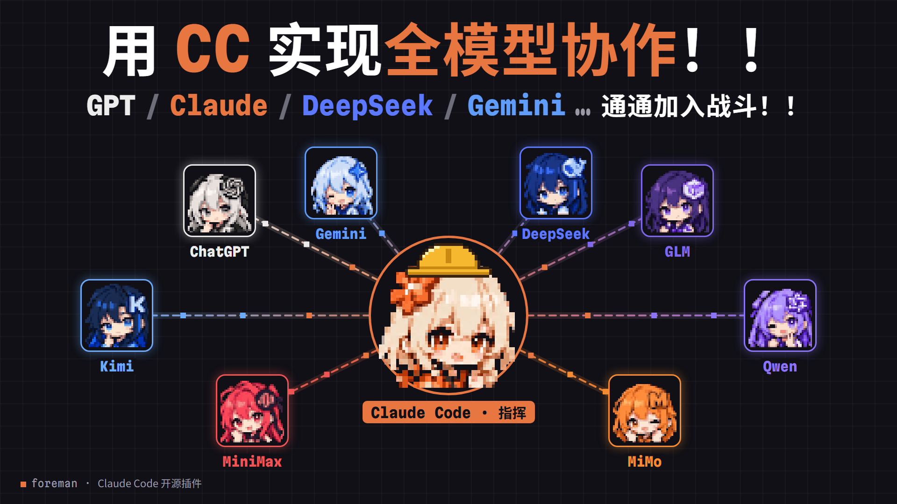
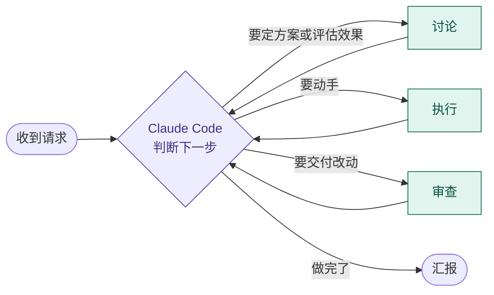
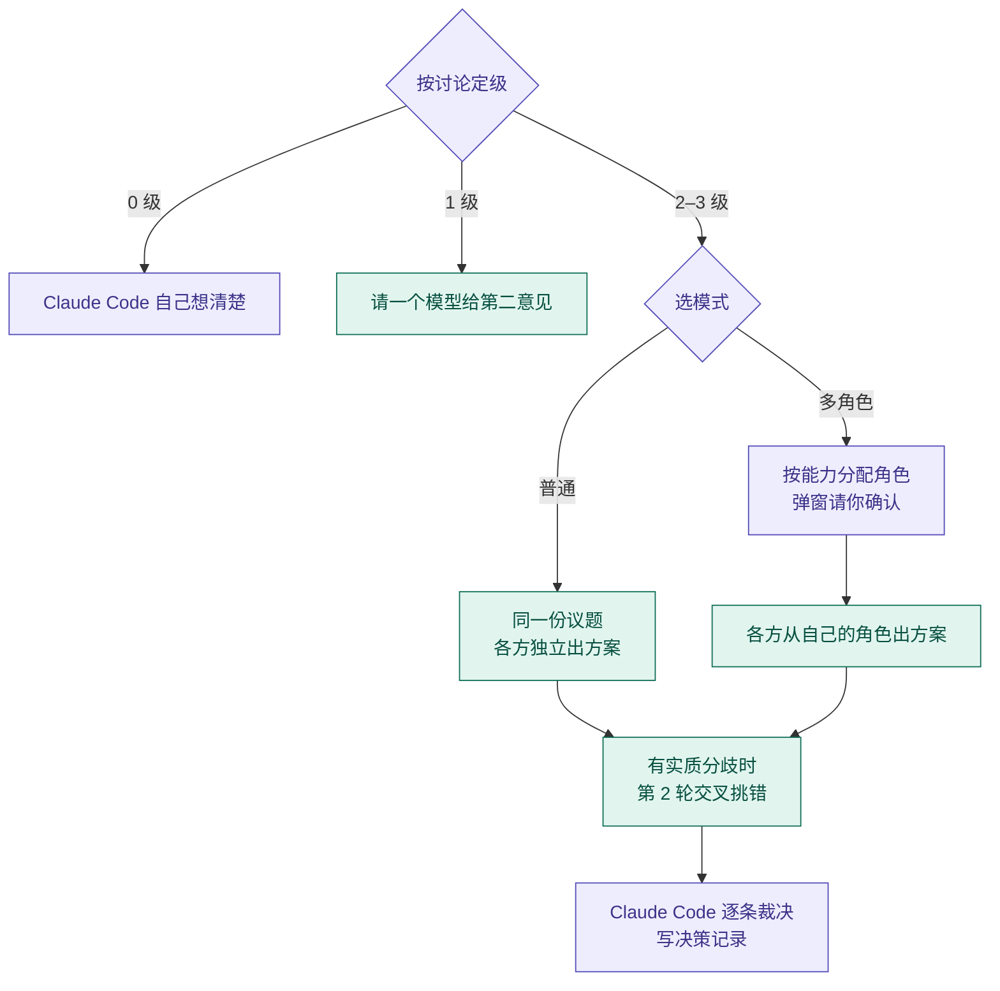
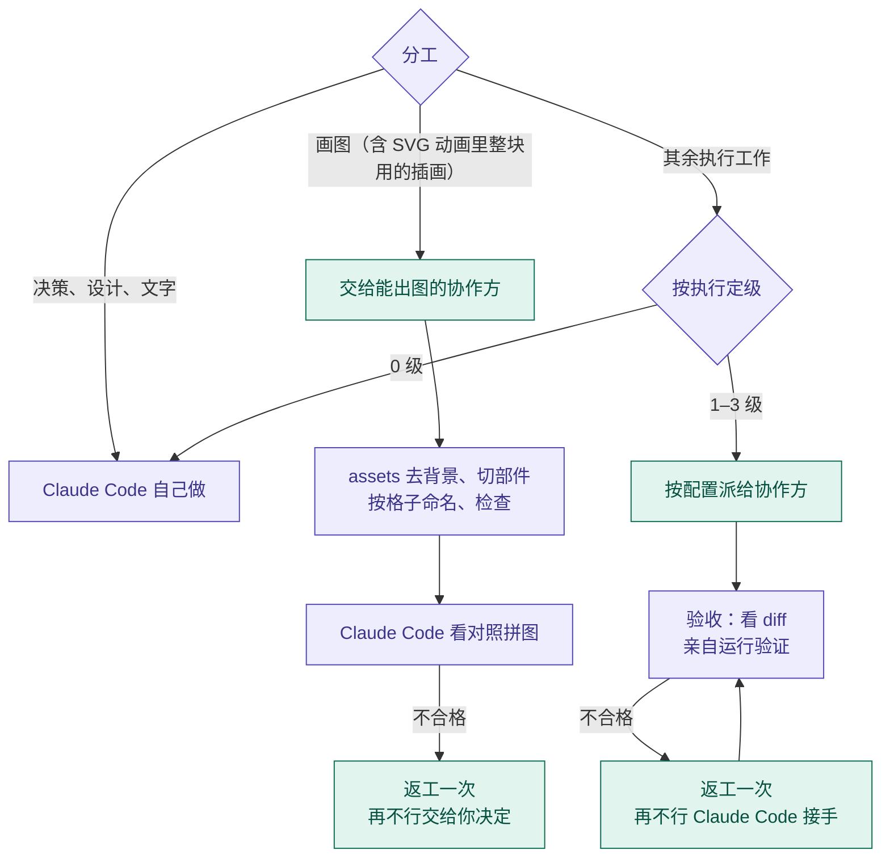
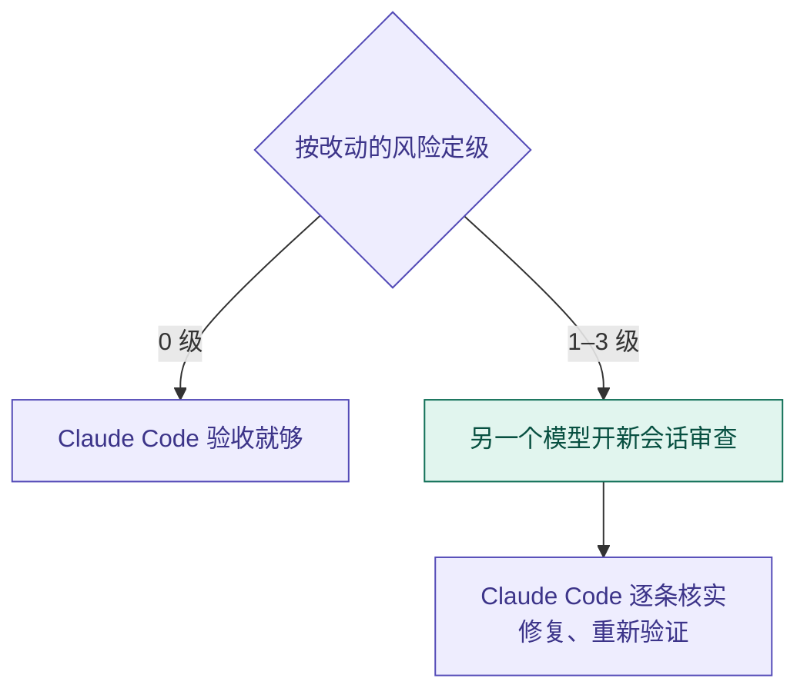

# claude-foreman

[English](README.en.md)



一个 Claude Code 插件，让 Claude Code 当"工头"：它负责规划、决策和验收，把动手的编码工作按你的配置派给 Codex、opencode、pi 等 CLI 工具，也能请它们独立审查代码，或者在复杂方案上召集几个模型一起讨论，最后由 Claude Code 裁决。

- **Claude Code 把关**：协作方交回的改动，Claude Code 逐个看 diff、实际运行验证，不合格就返工；讨论里各方的意见只作参考，接受还是拒绝由 Claude Code 按论据决定。
- **用你自己的额度**：协作方用的是你的 Codex 订阅、opencode 订阅或 API 余额，不占 Claude Code 的额度。
- **全程看得见**：每次派活都写明交给了谁、什么模型和推理强度；终端里能实时看到每个模型在做什么。

**介绍视频**：[在 B 站观看](https://www.bilibili.com/video/BV16XJv6pE2S/)

## 工作方式

插件分三个模块：**讨论**、**执行**、**审查**。它们没有固定顺序：Claude Code 每做完一步，都判断下一步该做什么，需要哪个模块就进哪个，一个请求里可以按任意顺序、多次进入。比如"讨论方案 → 执行 → 讨论实现效果 → 返工 → 审查"，或者"执行 → 审查 → 讨论审查指出的设计问题 → 再执行"。



每次进入一个模块，都按这一类的标准单独定级：不值得找外部模型的小事是 0 级，由 Claude Code 自己做；其余分简单、常规、复杂三级（`simple` / `normal` / `complex`），交给谁、用什么推理强度由你在配置里决定，写成 `"claude code"` 的那一级同样由 Claude Code 自己做。派出去之后终端里能实时看到模型的每一步，结束后 Claude Code 向你汇报用了哪个模型、花了多少 token。

三个模块各自的内部流程如下，紫色的步骤由 Claude Code 做，绿色的有协作方参与。

**讨论**



**执行**



**审查**



## 能做什么

| 命令 | 作用 |
|---|---|
| `/foreman:run <任务>` | 把一个执行任务派给配置的协作方，完成后 Claude Code 审查改动、实际运行验证，不合格就返工 |
| `/foreman:review` | 请协作方审查未提交的改动、某个分支或某次提交，Claude Code 逐条核实，排除误报 |
| `/foreman:discuss <议题>` | 几个模型就复杂方案各出方案、互相挑错，Claude Code 逐条裁决，给出决策记录；目标互相拉扯的议题可以用多角色模式，见下文 |
| `/foreman:watch` | 在终端里实时查看各个模型正在做什么，见下文 |
| `/foreman:status` | 查看最近的任务或某次任务的详细结果，包括 token 消耗和 Codex 额度 |
| `/foreman:setup` | 设置引导：检测本机的工具，列出能用的模型，给出一份完整推荐，按你的选择改好配置 |
| `/foreman:config` | 查看或修改配置 |

也可以直接对 Claude Code 说"检查一下环境"（`check`：每个协作方能不能用、配置的推理强度模型支不支持、Codex 的沙箱能不能启动），或者"列出能用的模型"（`models`）。

### 不用命令也行

插件自带的 skill 会让 Claude Code 每次进入讨论、执行或审查时分别定级，达到门槛的自己发起：

- 给出方案之前，以及执行之后要评估效果、决定下一步怎么调时，复杂、不确定的问题先找其他模型讨论，结论由 Claude Code 裁决。
- 动手之前，执行类工作按等级和配置派出；只由 Claude Code 做的工作（决策、设计、文字）和 0 级的小事不派。
- 交付之前，按改动的风险判断要不要请另一个模型审查。
- 大任务能拆成互不相干的几份时，同时派给几个会话，缩短等待（每个协作方的并发上限见 `max_parallel`）。

不想让 Claude Code 自己发起，把 `dispatch.auto` 设成 `false`：派活、讨论和审查之前它都会先问你。

上面表格里的命令只由你来输入，Claude Code 不会自己调用它们：这些命令表示"你点名要做"，会跳过 0 级判断。Claude Code 自己发起时走插件的 skill，照样定级、照样遵守 `dispatch.auto`。

### 多角色讨论

议题里有几个目标互相拉扯时（比如安全和便利、实现成本和体验、兼容和重构），或者是研究结论落地前的证据审查，2、3 级讨论可以改用多角色模式：每个模型带一张角色卡，从一个视角检查同一个议题，比如架构师、数学/正确性、实证核查员、维护与兼容、用户体验、边界清单员，再留一个不带角色的综合对照位。

- **按能力分配**：先看工具能不能做到（比如实证核查员要跑命令，只能给 Codex），再看模型档位（需要复杂思考的角色只给强档模型），最后在同档里挑长处合适的。模型档位按第三方评测分强、中、弱三档，见 [references/model-tiers.md](foreman/skills/dispatch/references/model-tiers.md)。
- **优先一个模型一个角色**：合格的模型不够时，让强档模型多开一个会话扮另一个角色，不降级给档位不够的模型；弱档模型只扮出错代价低的角色，没有合适的就这一场不参加。
- **一定先请你确认**：启动前弹窗列出"模型 → 角色"的分配，`dispatch.auto` 开着也一样；你可以按推荐开始、调整，或者改用普通讨论。
- 角色只决定各方重点检查什么，不决定结论；裁决照样按证据，几个角色意见一致不算多一份证据。
- 自定义角色、某类议题默认用多角色模式、对某个模型档位的不同看法，都可以写进偏好文件。角色表和分配规则见 [references/roles.md](foreman/skills/dispatch/references/roles.md)。

为了不让 Claude Code 忘了这些（项目里有自己的 skill 时尤其容易漏），插件会在每个会话开始时提醒它一次，并附上你的偏好文件。

### 出图素材

位图交给 Codex 的内置出图工具画，画完由 Claude Code 在本机用 `assets` 子命令处理成下游能直接用的素材：透明背景的部件 PNG、按名字列出的 manifest、对照拼图，扁平少色的再转成 SVG（每个部件一个图层，可以导入 Figma、Illustrator）。

- **SVG、HTML 和动画里同源取件**：Codex 只画整张定稿图（你看过、认可后才往下做），再在定稿图上改出一张去掉主体的背景板；作品里的部件都从这张定稿图上取。整块动的部件（头、躯干、道具、柜台）由 Claude Code 用 `assets layers` 按原位置裁出；本身要弯、要和代码画的东西精确接触的部件（弯曲的四肢、尾巴）交给 Codex 照定稿图手画成 SVG、写好变形，Claude Code 写任务说明并自己截图验收（对照试片里两边指标打平，盲看时 Codex 手画的更自然）；要按物理逐帧模拟的、要和机械对齐的、文字和 UI 控件用代码画。实测图像模型画不准关节转轴和接触点，单独取出的部件还会被放大（最多到两倍）、重画比例；同一张图上取出的部件接缝严丝合缝，线宽也一样。动手前会告诉你哪些部件整块动、哪些交给 Codex 描成路径弯曲。
- **表情只叠补丁**：眨眼、张嘴在定稿图上局部改图，只取变了的那一块叠上去，不整张换图，避免闪动。
- **角色这类细节多的画默认不转 SVG**：转出来又大又有色带，保留 PNG 嵌进页面。
- **多个部件按格子命名**：先画一张编号格子模板交给 Codex，让它把第 N 个部件画在第 N 格，切图时按格子命名，不会因为模型打乱顺序而张冠李戴。
- **改图和照参考图出图**：任务说明会写明把参考图通过 `referenced_image_paths` 传给出图工具；没传的话，结果里的 `image_calls` 会显示出来并提示。局部修改只替换被改的那个部件。
- **有量化的重出门槛**：背景板或表情改图测出的偏移超过 3 像素或缩放偏离超过 1%，背景板还留着主体残影，或者定稿图里会动的部件被压住，就改做法重出，不在下游打补丁、也不另写配准脚本绕过去。出图不设固定次数，同一个问题连续三次没改善才停下来问你。
- **补丁、描图、截图和播放检查也在本机做**：`assets patch` 从改图里只取变了的区域（眨眼、张嘴），`assets trace` 照定稿图描出要弯的部件（曲线轮廓，描边粗细均匀，Codex 手画时用它打底），`assets capture` 用本机的 Chrome 或 Edge 按时刻截图，`assets playback` 截下一圈动画，检查闪动、首尾衔接，并生成能直接播放的 APNG 给你看。
- **背景**：默认要透明背景，脚本清理边缘的淡光晕；主体是白色或浅色时改用品红纯色底。
- **扁平素材转 SVG 不用另装东西**：用插件自带的描图，直边是直线、曲线是贝塞尔曲线，对照拼图里能看到 SVG 画回来的样子。
- 做不到的：像素风、指定精确像素尺寸、超过约 157 万像素的高清图、让模型画单独的关节部件，以及需要定稿图里没有的那一面的大幅转身、换视角。

提示词模板、命令选项和各项检查见 [references/image-assets.md](foreman/skills/dispatch/references/image-assets.md)。

### 实时查看

- 默认是一条时间线：左边是时间，模型说的话、折叠后的命令、文件改动依次往下排，最底下一行实时显示用时、命令数和进度，结束时写出结果。
- 运行中画面随窗口大小重排。↑↓、PgUp/PgDn 或鼠标滚轮往回翻，End 回到最新，q 退出查看，任务照常运行。
- 多方讨论或任务组在一个窗口里按模型分块，每块显示状态、用时和最新几行。同组各块标题不同时（多角色讨论、拆开的执行任务），每块第一行是模型和状态，第二行是这一块的标题，续接的讨论会注明第几轮。某个 API 模型因为服务繁忙在排队时，按 x 可以终止它。
- 加 `--verbose` 看全部细节：思考过程、每条命令和输出、token 用量。
- 新派出的对话第一次打开时，先放几秒启动动画：模型的像素头像、"正在启动"和几句玩笑（单个模型 5 秒，讨论 10 秒），按任意键跳过，`dispatch.intro` 设成 `false` 可以关掉。头像按模型名认，认不出的用 ??? 头像。
- Claude 桌面版里，实时画面开在终端面板里，派活后自动打开；命令行版里，Claude Code 会把命令发给你，在另一个终端里运行。

## 前提

- [Claude Code](https://claude.com/claude-code)
- Node.js 18 或更高版本。在 WSL 里运行 Claude Code 时，WSL 里也要装 Node.js，否则插件的钩子会在每条命令前报错
- Git 2.25 或更高版本，用来追踪协作方改了哪些文件
- 协作方，有几个配几个（一个都没有也能装，那样所有工作由 Claude Code 自己做）：
  - [Codex CLI](https://github.com/openai/codex)，已安装并登录。推荐，生成图片只能交给它
  - [opencode](https://opencode.ai) 2.x 或 [pi](https://github.com/earendil-works/pi)，用来接入各家模型
  - 兼容 OpenAI 接口的模型 API key（比如 DeepSeek、Kimi、MiMo），只能参加讨论

## 安装和设置

**推荐在 Claude 桌面版的 Code 页里用。** 插件主要在桌面版上开发和测试：派活后实时画面会自动在终端面板里打开、切到前台，启动动画也是按桌面版的终端调的。命令行版同样能用，派活、审查、讨论都一样，区别只是实时查看要你自己在另一个终端里运行 Claude Code 给出的命令。

在 Claude Code 里运行：

```
/plugin marketplace add DaydayupV/claude-foreman
/plugin install foreman@claude-foreman
```

装好后运行 `/foreman:setup`。它检测本机有哪些工具，列出能用的模型和每个模型支持的推理强度，按你的情况给出一份完整推荐；你逐项调整后它改好配置，最后给出总配置情况：每类任务的每一级交给谁、哪些协作方没用上、有什么要注意的。装了新工具、想换模型时可以再跑。

从 codex-bridge 升级的，见[后面的说明](#从-codex-bridge-升级)。

## 配置

用户配置在 `~/.claude/foreman/config.json`，项目配置在 `<项目目录>/.claude/foreman.json`。可以直接编辑文件，也可以对 Claude Code 说"用 `/foreman:config` 把复杂任务改成 ultra"。字段的完整说明见 [references/config.md](foreman/skills/dispatch/references/config.md)。

### 第一次使用

第一次运行时，插件先检测本机有什么，再生成配置：

| 检测到 | 生成的安排 |
|---|---|
| 能用的 Codex（已安装、已登录） | 简单和常规的执行由 Claude Code 自己做，复杂的执行交给 Codex 的 `gpt-6.1-sol`；审查和讨论交给 Codex，复杂的用 `gpt-6-astra` |
| 没有 Codex | 所有任务暂时由 Claude Code 自己做 |
| API key 环境变量（DeepSeek、Kimi、MiMo） | 写进配置，先不加入讨论 |
| opencode、pi | 不自动加，用哪个模型由你选 |

花钱或有安全影响的选择不会自动做，交给 `/foreman:setup` 和你一起定。

### 配置的结构

配置分三块：

| 块 | 管什么 |
|---|---|
| `dispatch` | 插件怎么派活：是否主动派、实时查看、启动动画、讨论轮数、超时、记录目录 |
| `agents` | 有哪些协作方、怎么连接 |
| `levels` | 每类任务的每个等级交给谁，用什么推理强度 |

一个最小的例子：Codex 做复杂的执行和所有审查，复杂的讨论再加一个 opencode 里的模型。没写的字段用默认值。

```json
{
  "agents": {
    "gpt-6.1-sol": { "type": "codex cli", "model": "gpt-6.1-sol" },
    "gpt-6-astra": { "type": "codex cli", "model": "gpt-6-astra" },
    "glm-5.3":     { "type": "opencode cli", "model": "opencode-go/glm-5.3" }
  },
  "levels": {
    "run":     { "simple": "claude code", "normal": "claude code", "complex": { "agent": "gpt-6.1-sol", "effort": "max" } },
    "review":  { "simple": { "agent": "gpt-6.1-sol", "effort": "medium" }, "normal": { "agent": "gpt-6.1-sol", "effort": "high" }, "complex": { "agent": "gpt-6-astra", "effort": "max" } },
    "discuss": { "simple": "claude code", "normal": [{ "agent": "gpt-6.1-sol", "effort": "high" }], "complex": [{ "agent": "gpt-6-astra", "effort": "max" }, { "agent": "glm-5.3" }] }
  }
}
```

- `agents` 的键是协作方的**代号**，`levels` 和 `--agent` 用它引用。建议直接用模型名，可以用字母、数字、`.`、`-`、`_`。
- 三种任务（`run` 执行、`review` 审查、`discuss` 讨论）各分三级，另有一个不进配置的 0 级（见下文"任务等级"）。执行和审查写一个协作方，讨论写一组参与方。
- 写成 `"claude code"` 表示 Claude Code 自己做；对审查和讨论来说，就是这一级不找外部模型。
- `effort` 是推理强度，不写就用默认值。Codex 是 `low` 到 `ultra`；opencode 是模型的 variant；pi 是 thinking 档位；API 原样作为 `reasoning_effort` 发出。

### 四种协作方

| `type` | 是什么 | 能做的任务 | 自己读代码 | 隔离 | 用谁的额度 |
|---|---|---|---|---|---|
| `codex cli` | 本机的 Codex CLI | 执行、审查、讨论、生成图片 | 能 | Codex 自己的沙箱 | Codex 订阅或 OpenAI API |
| `opencode cli` | 本机的 opencode，接入它支持的各家模型 | 审查、讨论；写了 `run_access` 还能执行 | 能 | 只限定工具，没有系统沙箱 | 在 opencode 里登录的厂商，或 OpenCode Go 订阅 |
| `pi cli` | 本机的 pi，接入它支持的各家模型 | 同 opencode | 能 | 同 opencode，读写路径由插件注入的守卫检查 | 在 pi 里登录的厂商 |
| `api` | 兼容 OpenAI 接口的模型 | 讨论 | 不能，Claude Code 把相关文件附过去 | 不涉及 | 厂商的 API 余额 |

同一种可以配多个，各用不同模型。Codex 不是必需的。

### 任务等级

Claude Code 每次进入讨论、执行或审查时，都按这一类的标准单独定级；同一类在一个请求里再次出现，也重新定级。三类的标准不一样：

| 等级 | 讨论（看决策的不确定性和选错的代价） | 执行（看要多少判断、出错的代价） | 审查（看被审改动的风险） |
|---|---|---|---|
| 0 级 | 方案已经明确或你已拍板：不找外部模型 | 一处就能改完、自己改比写任务说明还快的小改动 | 小改动、文档、样式、配置，或有测试覆盖的低风险改动：Claude Code 验收就够 |
| 1 `simple` | 需要第二意见的一次性问答 | 做法确定、几乎不用判断 | 改动量大但很机械 |
| 2 `normal` | 有几个方案要比较，影响有限 | 有规格，细节要自己设计 | 较大的一般功能和修复 |
| 3 `complex` | 复杂、不确定、选错代价高 | 根因不明、出错代价高、跨模块 | 金额、数据、并发、鉴权等高风险代码 |

0 级固定由 Claude Code 自己做，不在配置里；1–3 级交给谁、用什么推理强度由你在 `levels` 里决定。等级看判断和风险，不看改动多少：照清单机械地改 20 个文件是简单，改模块之间的接口是复杂。派出去的每次调用都必须带上等级，漏了脚本直接报错，不会悄悄按某个档位运行。

- 想临时指定时，对 Claude Code 说"用 ultra 跑"或"用某某模型跑"，Claude Code 会改用 `--effort` 或 `--model`。
- 某一级写成 `"claude code"` 时，你仍然可以明确要求把某个任务派出去，Claude Code 会用 `--agent` 点名。
- 0 级只限一处就能改完的小改动。默认 `simple` 也由 Claude Code 自己做；把 `simple` 交给协作方的话，除了 0 级的小改动，其余的活都会派出去。

### 接入 API 模型

1. **加协作方**：`{ "type": "api", "base_url": "...", "model": "..." }`。兼容 OpenAI 接口的都行，比如 DeepSeek、Kimi、MiMo、GLM、通义千问、OpenRouter；有特殊参数时写在 `extra_body` 里，会原样并进请求。
2. **填 key**，二选一：
   - 环境变量：写 `"api_key_env": "DEEPSEEK_API_KEY"`，再设置这个环境变量。Windows 上在"系统属性 → 环境变量"里加一个用户变量；macOS 和 Linux 写进 shell 的启动文件。设置后重启 Claude Code 才能读到。
   - 配置文件：写 `"api_key": "sk-..."`，立即生效，但是明文保存，这个文件不要提交或分享。两种都写时，以配置文件里的为准。
3. **加进讨论**：在 `levels.discuss` 需要的等级里加上它。

也可以交给 `/foreman:setup`，比如运行 `/foreman:setup 加 DeepSeek`；key 由你自己填，不用发到对话里。API 模型自己翻不了代码，Claude Code 会把相关文件随议题附过去（每次上限约 30 万字符），并对照原文核实它对代码的说法。

### 接入 opencode

装了 opencode 2.x 的话，它里面能用的模型都可以参加讨论和审查，比如 [OpenCode Go](https://opencode.ai/docs/go/) 订阅里的 GLM、Kimi、Qwen、MiniMax、DeepSeek。它们能自己读项目里的代码，代价是每读一次文件多一次请求，更费额度。

1. **登录**：终端运行 `opencode`，用 `/connect` 登录（OpenCode Go 选 OpenCode Go），再运行 `opencode models` 看能用哪些模型。名字带 `-free` 的免费模型不要配：OpenCode 现在只允许在它自己的界面里用免费模型，从命令行调用会被拒绝（报错 "OpenCode's free tier can only be used from within OpenCode"）。
2. **加进配置**：每个模型加一项 `{ "type": "opencode cli", "model": "opencode-go/glm-5.3" }`，再加进需要的等级。也可以交给 `/foreman:setup`。

讨论和审查时，插件给它注入一个只读代理，只有读文件、搜索和列目录的工具；审查要看的改动由插件用 git 算好附给它。key 和登录都留在 opencode 里。结果里带上这一轮折算的费用（`cost_usd`），OpenCode Go 的额度就按这个扣；Go 的额度按模型分开算，高档模型额度少，建议只放在复杂讨论里。

### 接入 pi

装了 pi（`npm install -g @earendil-works/pi-coding-agent`）的话，用法和 opencode 一样。

1. **登录**：终端运行 `pi`，用 `/login` 登录要用的厂商（或者设置厂商的 API key 环境变量），再运行 `pi --list-models` 看能用哪些模型。
2. **加进配置**：每个模型加一项 `{ "type": "pi cli", "model": "deepseek/deepseek-flash" }`，再加进需要的等级。

- 推理强度是 pi 的 thinking 档位（`off` 到 `max`），每个模型支持的不一样。**写了模型不支持的档位，pi 不报错，会悄悄换成最接近的一档**，所以改完运行一次 `check`，它会说明会被换成哪一档。
- pi 本身没有权限系统。插件每次只开放这次任务需要的工具，注入守卫扩展让读写路径不出项目目录，也不加载你自己装的扩展、skill 和 MCP。项目的 AGENTS.md / CLAUDE.md 照常读，会话存在 pi 的默认位置。

### 让 opencode 或 pi 做执行任务

在用户配置里给这个协作方写 `run_access`，再放进 `levels.run`（项目配置开不了）：

- `"edit"`：只能读写项目目录里的文件，不能运行命令，测试由 Claude Code 事后跑。
- `"shell"`：还能运行命令，比如跑测试。没有系统沙箱，命令以你的账户权限运行、能访问整台机器，只适合你信任的项目和模型。

两档都会先拍改动快照，Claude Code 事后逐个文件审查 diff。

### 完整示例

<details>
<summary>展开：四种协作方都用上的一份完整配置</summary>

```json
{
  "dispatch": {
    "auto": true,
    "watch": "auto",
    "intro": true,
    "discuss_max_rounds": 2,
    "timeout_min": 240,
    "stall_min": 20,
    "busy_ask_min": 2
  },
  "agents": {
    "gpt-6-astra":        { "type": "codex cli", "model": "gpt-6-astra" },
    "gpt-6.1-sol":        { "type": "codex cli", "model": "gpt-6.1-sol" },
    "deepseek-flash":     { "type": "opencode cli", "model": "deepseek/deepseek-flash" },
    "glm-5.3":            { "type": "opencode cli", "model": "opencode-go/glm-5.3" },
    "mimo-v2.6-pro":      { "type": "pi cli", "model": "xiaomi/mimo-v2.6-pro" },
    "kimi-k2.6":          { "type": "api", "base_url": "https://api.moonshot.cn/v1", "api_key_env": "KIMI_API_KEY", "model": "kimi-k2.6" }
  },
  "levels": {
    "run": {
      "simple":  "claude code",
      "normal":  "claude code",
      "complex": { "agent": "gpt-6.1-sol", "effort": "max" }
    },
    "review": {
      "simple":  { "agent": "gpt-6-astra", "effort": "medium" },
      "normal":  { "agent": "gpt-6-astra", "effort": "high" },
      "complex": { "agent": "gpt-6-astra", "effort": "max" }
    },
    "discuss": {
      "simple": [
        { "agent": "gpt-6-astra", "effort": "medium" },
        { "agent": "glm-5.3" }
      ],
      "normal": [
        { "agent": "gpt-6-astra", "effort": "high" },
        { "agent": "deepseek-flash", "effort": "high" },
        { "agent": "glm-5.3" }
      ],
      "complex": [
        { "agent": "gpt-6-astra", "effort": "max" },
        { "agent": "deepseek-flash", "effort": "max" },
        { "agent": "kimi-k2.6" },
        { "agent": "mimo-v2.6-pro", "effort": "high" },
        { "agent": "glm-5.3" }
      ]
    }
  }
}
```

| 代号 | 接入方式 | 用在哪 |
|---|---|---|
| `gpt-6.1-sol` | Codex CLI | 复杂的执行 |
| `gpt-6-astra` | Codex CLI | 所有审查，三级讨论都参加 |
| `glm-5.3` | opencode（OpenCode Go 订阅） | 三级讨论都参加 |
| `deepseek-flash` | opencode | 常规和复杂的讨论 |
| `mimo-v2.6-pro` | pi | 复杂的讨论 |
| `kimi-k2.6` | API，key 在环境变量 `KIMI_API_KEY` 里 | 复杂的讨论 |

简单和常规的执行由 Claude Code 自己做；讨论的人数随等级增加，越复杂请越多模型。

这份配置没用到、但常会调整的字段：

```json
"gpt-6.1-sol":        { "type": "codex cli", "model": "gpt-6.1-sol", "sandbox": { "run": "workspace-write" }, "max_parallel": 2 },
"glm-5.3":            { "type": "opencode cli", "model": "opencode-go/glm-5.3", "run_access": "edit" },
"deepseek-v4-pro":    { "type": "api", "base_url": "https://api.deepseek.com", "api_key_env": "DEEPSEEK_API_KEY", "model": "deepseek-v4-pro", "extra_body": { "temperature": 0.3 } }
```

- `sandbox`：Codex 每类任务（`run`、`review`、`discuss`）用的沙箱，`read-only`、`workspace-write` 或 `danger-full-access`；不写就用 Codex 自己的配置。Windows 上不要用 `read-only`。
- `max_parallel`：这个协作方同时最多跑几个任务，默认 4。
- `run_access`：允许 opencode 或 pi 做执行任务，见上文。
- `extra_body`：API 请求里额外带的参数。
- `bin`：找不到命令时，写可执行文件的完整路径。

</details>

### 项目配置

项目配置只能收紧，不能放宽：

- 只认 `dispatch.timeout_min`、`dispatch.stall_min`、`dispatch.busy_ask_min` 和 `levels`；
- 每一级只能改成 `"claude code"`，或者从用户配置这一级已有的协作方里选（可以改推理强度）。

这样别人的仓库没法借项目配置换掉执行方、把代码发给新的厂商，或者擅自花你的额度。敏感项目可以把讨论改成只留 Codex，或者直接写成 `"claude code"`。

### 偏好文件

有些习惯不好写成 JSON，比如你的项目里哪类代码算高风险、哪些活不想派出去。这些可以用文字写在偏好文件里，Claude Code 每个会话开始用插件时会读：

- 用户级：`~/.claude/foreman/preferences.md`
- 项目级：`<项目目录>/.claude/foreman.md`

和插件自带的规则冲突时，以偏好文件为准，项目级优先于用户级。例如：

```markdown
# foreman 偏好

- 这个项目的计费和对账代码按高风险处理：派活用 complex，改完都请 Codex 审查。
- 数据库迁移脚本不派出去，由 Claude Code 自己写。
- 改动超过 200 行就请 Codex 审查。
- 性能和可维护性互相拉扯的讨论用多角色模式；kimi-k2.6 按强档模型对待。
```

多角色讨论的自定义角色也写在这里，格式见 [references/roles.md](foreman/skills/dispatch/references/roles.md) 的"用户自定义角色"。

## 安全提示

- **Claude Code 只能通过插件调用协作方。** 插件带有一个钩子：Claude Code 直接运行 `codex exec`、`codex review`、`opencode run` 或用 pi 跑任务的命令会被拦下，这样每次调用都有记录、改动追踪和明确的模型和推理强度。你自己在终端里运行它们不受影响。
- **Codex 的隔离靠它自己的沙箱。**
  - 沙箱以 Codex 的配置为准。是 `danger-full-access` 时，Codex 能读写电脑上的任何目录；任务说明会限定改动范围、Claude Code 事后也会审查 diff，但这些都不是技术上的隔离。想要隔离，把 `agents.<代号>.sandbox` 设成 `workspace-write` 或 `read-only`（Windows 上用 `workspace-write`：只读沙箱可能连读文件的命令都启动不了）。
  - Windows 上 Codex 默认的 elevated 沙箱要先以管理员身份完成一次设置，设置坏了每条命令都会失败（报 `windows sandbox failed`）。改了沙箱之后让 Claude Code 运行一次 `check`：它不调模型地测一遍沙箱，坏了会列出修法，比如改用 `[windows] sandbox = "unelevated"`。
  - 审批 `approval` 保持默认的 `never` 就好：派出去的任务没人能批准，沙箱坏了要修沙箱。
- **opencode 和 pi 做执行时没有系统沙箱。** `edit` 档写不了项目以外的文件、不能运行命令；`shell` 档的命令能访问整台机器。默认不开放，要你自己在用户配置里写，项目配置开不了。
- **代码会发给协作方背后的厂商。** 派给 Codex 的发给 OpenAI；opencode、pi 和 API 模型发给对应的厂商，API 模型还会收到 Claude Code 附上的文件。涉及敏感代码的项目先确认没问题，必要时用项目配置收紧。
- **API key 可以写在用户配置里，也可以放在环境变量里。** 写在配置里是明文，`~/.claude/foreman/config.json` 不要提交或分享；项目配置里写的 key 不生效。`config` 命令不显示 key，脚本也不会把 key 写进运行记录。
- **按量计费的都会产生费用。** Codex 用 API key 计费时、API 模型、opencode 和 pi 接入的按量计费厂商，每次派活或讨论都会花钱。不想让 Claude Code 自己发起派活、讨论和审查，就把 `dispatch.auto` 设成 `false`，它会先问你。
- **协作方不会因为等人回答而卡住。** Codex 默认不需要审批，opencode 不开放提问和需要确认的权限，pi 没有提问工具。它们要人回答的事都收集在结果里，由 Claude Code 判断：你已有授权内的直接决定后续接，业务取舍、扩大范围、花钱和不可逆的操作才问你。

## 运行记录

每次调用都会在 `~/.claude/foreman/runs/<run_id>/` 留档：任务说明、事件流、diff、最终报告。API 模型的运行没有 diff，另外多一份对话历史 `messages.json`，续接时接着发。`/foreman:status` 可以查看。

- 改动追踪用的是放在记录目录里的独立 git 仓库，不会碰你项目里的 `.git`。它比较任务开始和结束时的整个工作目录，所以同一时间你、Claude Code 或别的会话改的文件也会被看到：有证据是协作方改的文件和归属未知的文件分开标出，Claude Code 不会直接还原归属未知的改动。
- 被 `.gitignore` 忽略的路径默认不追踪，派活时用 `--track` 指定后才会追踪。
- Codex 额度用完、API 余额不足时，任务标记为 `quota_exhausted`，不会自动重试；Codex 的会带上预计恢复时间。
- 调度进程意外退出、卡死或超时的任务，下次在这个项目里开会话时，Claude Code 会收到提醒。

## 平台支持

主要在 Windows 的 Claude 桌面版（含 Microsoft Store 版）上开发和测试；命令行版也测过，插件、命令和钩子的加载和桌面版一样。macOS 和 Linux 的代码路径已经写好，但还没有实际测试，欢迎反馈问题。

- **桌面版的实时查看**开在终端面板里，终端面板只接受 ASCII 命令。记录目录（默认 `~/.claude/foreman/runs`）的路径里有中文等字符时（比如 Windows 用户名是中文），`/foreman:setup` 会提示；在配置里把 `dispatch.runs_dir` 设成纯英文路径就行。命令行版不受影响。
- **从图形界面启动的程序**（比如 macOS 桌面版）PATH 里可能没有 Homebrew、nvm 等目录。脚本找不到命令时，会再到 node 所在的目录、`/opt/homebrew/bin`、`/usr/local/bin` 等常见位置找；仍然找不到，就在这个协作方里写上 `bin`（可执行文件的完整路径）。插件的钩子要用 `node`，也需要能在 PATH 里找到它。
- **实时查看**用到全屏重画，Windows Terminal、macOS 的终端和 iTerm2、VS Code 的终端以及常见的 Linux 终端都支持；`TERM=dumb` 这类简单终端会改成逐行输出。启动动画用 24 位色，macOS 自带的终端会自动改用 256 色；它主要在 Claude 桌面版的终端里看过，别的终端里显示不对时，用 `dispatch.intro: false` 关掉。

## 从 codex-bridge 升级

这个插件原来叫 codex-bridge。Claude Code 不会把旧插件自动升级成新名字，需要手动换一次：

1. 卸载旧插件：`/plugin uninstall codex-bridge@claude-codex-bridge`。新旧插件同时装着时，两边的钩子会重复拦截、重复提醒。
2. 按[安装](#安装和设置)的步骤添加新的 marketplace，安装 `foreman`。
3. 用桌面版"我的上传"装过旧插件的，在那里把它删掉。

你的设置会在新插件第一次运行时自动搬过去：

| 原来 | 现在 |
|---|---|
| 插件 `codex-bridge` / `codex-bridge-en`，marketplace `claude-codex-bridge` | `foreman` / `foreman-en`，marketplace `claude-foreman` |
| `/codex-bridge:rescue` | `/foreman:run`；其他命令只换前缀 |
| 配置 `~/.claude/codex-bridge.json` | `~/.claude/foreman/config.json`（自动复制） |
| 偏好 `~/.claude/codex-bridge.md` | `~/.claude/foreman/preferences.md`（自动复制） |
| 运行记录 `~/.claude/codex-runs` | `~/.claude/foreman/runs`（整个搬过去；旧目录里还有任务在跑时，下次再搬） |
| 项目里的 `.claude/codex-bridge.json`、`.claude/codex-bridge.md` | `.claude/foreman.json`、`.claude/foreman.md`（旧名照常能读，会提示改名） |
| 环境变量 `CODEX_BRIDGE_CONFIG`、`CODEX_RUNS_DIR`、`CODEX_BRIDGE_LANG` | `FOREMAN_CONFIG`、`FOREMAN_RUNS_DIR`、`FOREMAN_LANG`（旧名暂时还认） |

配置还会改成新写法：`type` 改为 `codex cli` / `opencode cli` / `api`，`"claude"` 改为 `"claude code"`，协作方代号改成模型名（比如 `codex` 改为 `gpt-6-astra`）。每一级实际用的模型和推理强度不变，原文件备份为 `config.json.bak`。旧配置和旧偏好文件保留，确认没问题后可以自己删掉。

## 中文版和英文版

插件市场里有两个插件，规则和输出的语言不同，其余完全一样：

- `foreman`：中文版，命令是 `/foreman:…`
- `foreman-en`：英文版，命令是 `/foreman-en:…`

只装其中一个就行。两者共用同一份配置文件、偏好文件和运行记录，换装另一个不用重新配置。

## 开发

两个插件的脚本是同一份：`skills/dispatch/scripts/` 下除 `language.json` 以外的全部文件（入口是 `cli.mjs`），以及 `hooks/` 下的两个钩子。只改 `foreman/` 里的那份，再运行同步工具复制到英文插件：

```bash
node tools/sync-shared.mjs
```

- 提交前可以用 `node tools/sync-shared.mjs --check` 检查两份脚本、两份 schema 的结构和两个插件的版本号是否一致。
- 测试：`npm test`（只用 Node 内置模块，不用装依赖），说明见 [tests/README.md](tests/README.md)。
- 终端提示、发给协作方的约束和提示词都在 `messages.mjs` 里，中英文各一份；各个 skill 的 `SKILL.md`（斜杠命令也是 skill，在 `skills/<命令名>/SKILL.md`）、`references/` 和 schema 两个插件各写各的。
- `references/model-tiers.md` 的模型档位按第三方评测整理，评测几个月就变，每次发版前对照最新结果更新一次。
- 启动动画的头像数据由 `node tools/make-avatars.mjs` 从 `tools/avatars/source.webp` 生成。

## 许可证

[MIT](LICENSE)
