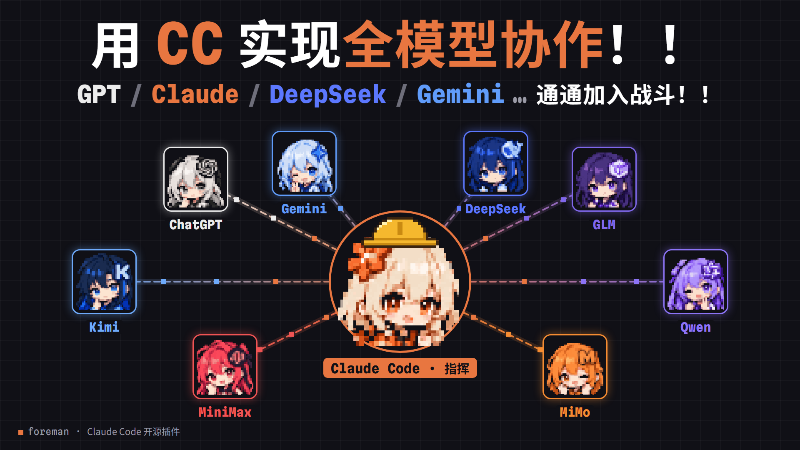
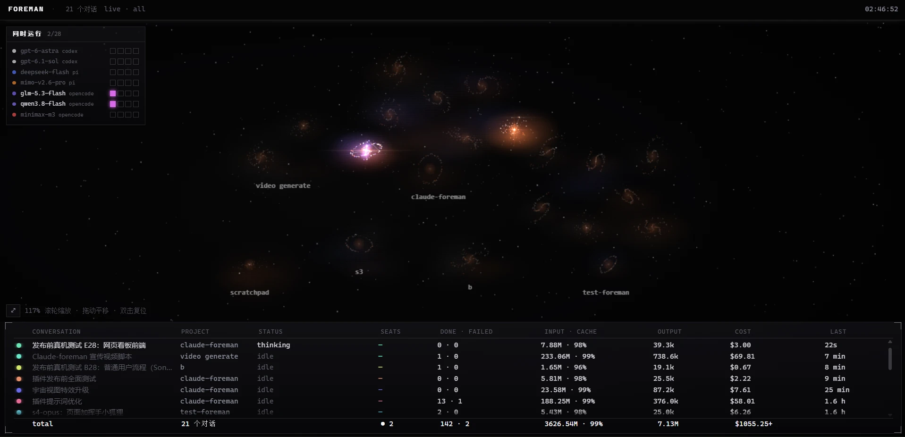
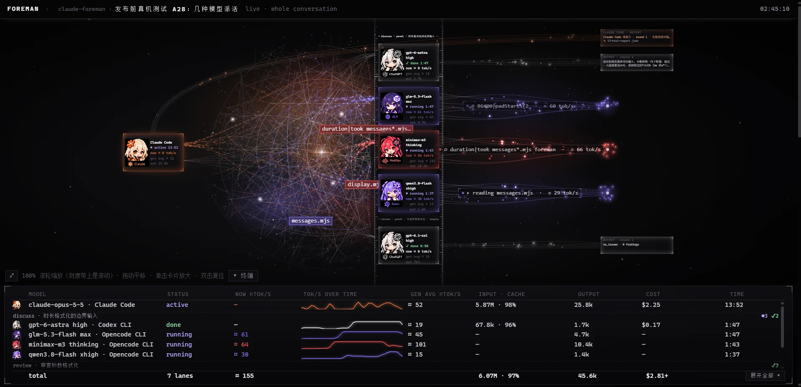
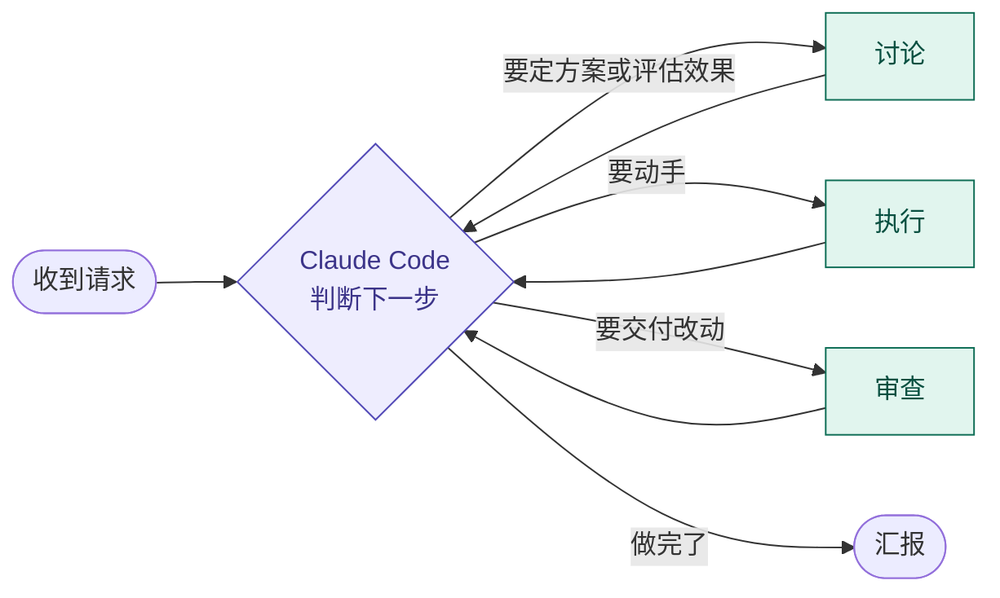
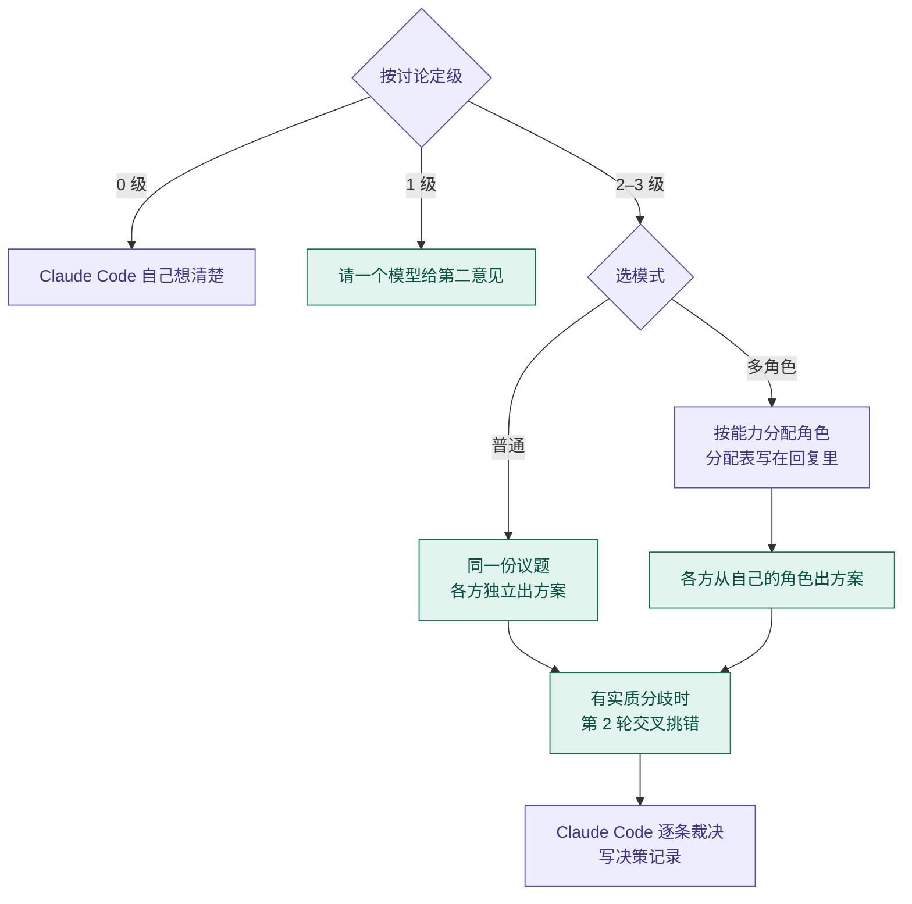
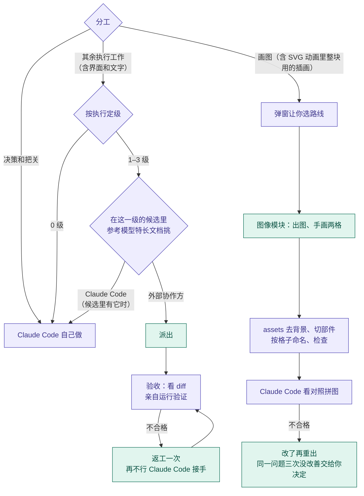
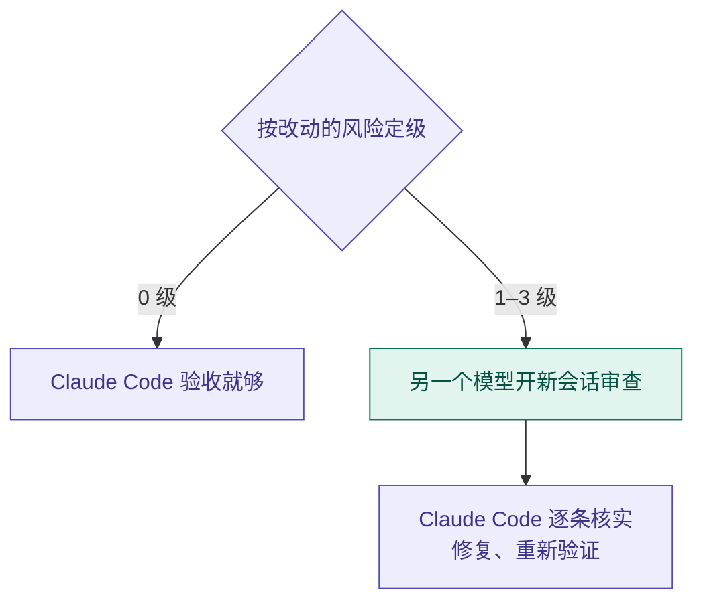

# claude-foreman

[](LICENSE)
[](https://linux.do)
[](https://github.com/DaydayupV/claude-foreman/pulls)
[](https://github.com/DaydayupV/claude-foreman/stargazers)

[English](README.md)



foreman 是一个 Claude Code 插件，让 Claude Code 当你手上其他 AI 编程工具的"工头"。规划、决策和验收仍由 Claude Code 负责；动手写代码、出第二意见、审查代码这些活，按你的配置交给 Codex、opencode、pi、agy、CodeBuddy，或者任何兼容 OpenAI 接口的模型。

- **Claude Code 把关**：协作方交回的每一处改动，它都逐个看 diff、实际运行，不对就打回返工；讨论里别的模型的意见只作参考，每一条接不接受由 Claude Code 按论据决定。
- **一个对话里用上多家模型**：不同厂商的模型可以一起讨论方案、一起审查改动，各看各的角度。
- **用你自己的额度**：协作方走的是你的 Codex 订阅、opencode 订阅或 API 余额，不占 Claude Code 的额度。
- **全程看得见**：每次派活都写明交给了谁、什么模型和推理强度，每个模型在做什么都能实时看到。

**介绍视频**：[在 B 站观看](https://www.bilibili.com/video/BV13sxL6aE4Z/)

网页看板的星图：本机最近的每个对话是一个星系，正在派活的星系会发亮。



飞进一个对话：四个模型同时讨论，每一席的进度、实时速度、产出和费用一目了然。



## 用起来是什么样

装好以后，你照常跟 Claude Code 说要做什么，不用记任何命令。比如：

> 给订单导出加一个按日期筛选，顺便补上测试。

Claude Code 会把这件事拆成几步，每一步先判断值不值得请别的模型来：

1. **定方案**：做法明确就直接动手；有几种做法要比较、选错代价又高，就请几个模型各出方案、互相挑刺，再由它拍板，并告诉你采纳了哪些、没采纳哪些。
2. **动手**：小改动它自己做，成块的编码工作按你的配置交给 Codex、opencode、pi、agy 或 CodeBuddy。每次派出都写明交给了谁、用什么模型和推理强度，你在终端或网页看板里能实时看到对方在做什么。
3. **验收**：交回的改动，它逐个文件看 diff、实际跑测试，不合格就打回返工。
4. **交付前审查**：改动有风险时，再请另一个模型开新会话独立审一遍。每条问题它都对照代码核实，误报直接剔除。

最后它会告诉你每一步是谁做的、用了多少 token，按官方价格大约花了多少钱。



**你始终说了算**

- 每一级的活交给谁、派几家、谁必须参加，都写在配置里，`/foreman:setup` 会带你配好。
- 什么时候先停下来问你，由暂停确认节点决定。默认只在 3 级讨论和 2 级以上的审查要采纳结果之前问。
- 你对各个模型的了解（擅长什么、容易在哪里出错）写进[模型特长文档](#模型特长文档)，Claude Code 挑人、写任务说明和验收时都会参考。

## 安装和设置

### 在 Claude 桌面版里安装（推荐）

foreman 主要在 Claude 桌面版的 Code 页里开发和测试，在那里每次派活后，实时画面会自己在终端面板里打开。

1. 从[最新 release](https://github.com/DaydayupV/claude-foreman/releases/latest) 下载插件包：中文版是 `foreman.plugin`，英文版是 `foreman-en.plugin`。装一个就行（见[中文版和英文版](#中文版和英文版)）。同一个插件的 `.zip` 和 `.plugin` 内容完全相同。
2. 在 Claude 桌面版里把这个文件作为插件上传，装好后列在"我的上传"里。
3. 打开 Code 页，运行 `/foreman:setup`（见[运行设置](#运行设置)）。

### 从 marketplace 安装

在 Claude Code 命令行版里，或者在桌面版里不想上传文件时，运行：

```
/plugin marketplace add DaydayupV/claude-foreman
/plugin install foreman@claude-foreman
```

英文版装 `foreman-en@claude-foreman`。命令行版派活、审查、讨论都和桌面版一样，区别只是实时画面要你自己在另一个终端里打开，Claude Code 会给你命令。

以后怎么升级，见[升级](#升级)。

### 前提

- [Claude Code](https://claude.com/claude-code)
- Node.js 18 或更高版本。在 WSL 里运行 Claude Code 时，WSL 里也要装 Node.js，否则插件的钩子会在每条命令前报错。
- Git 2.25 或更高版本，用来追踪协作方改了哪些文件。
- 协作方，有几个配几个。一个都没有也能用，那样所有工作都由 Claude Code 自己做。
  - [Codex CLI](https://github.com/openai/codex)，已安装并登录。推荐，生成图片只能交给它。
  - [opencode](https://opencode.ai) 2.x 或 [pi](https://github.com/earendil-works/pi)，用来接入各家模型。
  - Agy CLI（Google Antigravity CLI），已安装并登录。目前只在 Windows 11 上验证过。
  - CodeBuddy CLI（腾讯云代码助手），已安装并登录。目前只在装了 Git for Windows 的 Windows 11 上验证过。
  - 兼容 OpenAI 接口的模型 API key，比如 DeepSeek、Kimi、MiMo，能参加讨论和审查。

### 运行设置

装好后运行 `/foreman:setup`。它会检查这台机器，带你把配置配好：

- **找到了什么**：你装了哪些工具、它们能用的全部模型，以及每个模型支持的推理强度。
- **现在的配置**：每类活的每一级交给谁、派几家、谁必选，有什么要注意的。
- **修改建议**：每条都用一两句话说明。第一次设置或刚升级时，会先列出这一版的新东西、哪些要你动手。你可以在弹窗里一次接受，也可以逐项调整。

最后它写好配置，生成或补全你的[模型特长文档](#模型特长文档)，并列出你可以自己改的五个文件在这台机器上的完整路径（见[配置](#配置)）。装了新工具、想换模型时，再跑一次就行。

### 中文版和英文版

有两个插件，只有语言不同：

- `foreman`：中文，命令是 `/foreman:setup` 这样
- `foreman-en`：英文，命令是 `/foreman-en:setup` 这样

装一个就行。两者读的是同一份配置、偏好文件、模型特长文档和运行记录，换语言不用重新设置。

## 工作方式

### 三个模块

foreman 分三个模块：**讨论**、**执行**、**审查**。它们没有固定顺序，Claude Code 每做完一步都判断下一步该做什么，所以一个请求可以是"讨论方案 → 执行 → 审查"，也可以是"执行 → 审查 → 讨论审查指出的设计问题 → 再执行"。

### 等级

每次进入一个模块，Claude Code 都按这个模块自己的标准给这一步定级。0 级是小到它自己做就行的事；1–3 级（`simple`、`normal`、`complex`）交给你在配置里给这一级写的候选。

| 等级 | 讨论：有多不确定、选错代价多大 | 执行：要多少判断、出错代价多大 | 审查：改动有多大风险 |
|---|---|---|---|
| 0 | 方案已经明确，或者你已经拍板 | 一处就能改完，写说明还不如自己改 | 小改动、文档、样式、配置，或者有测试覆盖的低风险改动 |
| 1 `simple` | 需要第二意见的一次性问题 | 做法已经定了，几乎不用判断 | 改动量大但很机械 |
| 2 `normal` | 有几个方案要比较，影响有限 | 有规格，细节要自己设计 | 较大的一般功能和修复 |
| 3 `complex` | 复杂、不确定、选错代价高 | 根因不明、出错代价高，或者跨模块 | 碰到金额、数据、并发、权限的代码 |

定级看的是判断和风险，不看改动多少：照清单在 20 个文件里改名是简单，改模块之间的接口是复杂。审查按改动的代码可能影响到什么来定级，算改动量时只算手写的代码，不算文档和生成的文件。

### 谁做什么

- **决策和把关始终是 Claude Code 的事**：规划、给每一步定级、挑人、写任务说明、验收、裁决讨论和审查意见，以及向你汇报。
- **执行**的 1–3 级交给这一级的候选。写成 `"claude code"` 的那一级由 Claude Code 自己做；候选里也可以把 Claude Code 和外部协作方写在一起，这时只有[模型特长文档](#模型特长文档)写明它的模型更擅长这类活，它才自己做。
- **讨论和审查**里，Claude Code 始终占一席，再加上这一级要的外部模型。
- **出图**走单独的图像模块，开工前由你选路线（见[出图](#出图)）。
- 必选的模型失败或额度用完时，这一步算没做完，不会悄悄换别的模型顶上。

<details>
<summary>每个模块内部的流程</summary>

紫色的步骤由 Claude Code 做，绿色的有协作方参与。

**讨论**



**执行**



**审查**



</details>

## 日常使用

### 命令

这些命令不用也行，想点名要什么的时候可以用：

| 命令 | 作用 |
|---|---|
| `/foreman:run <任务>` | 把任务派给配置好的协作方，做完由 Claude Code 看 diff、运行验证，不合格就返工 |
| `/foreman:review` | 请协作方审查未提交的改动、某个分支或提交、已有的文件、研究结论及其证据，或者截图和播放文件。每条发现 Claude Code 都核实，误报剔除 |
| `/foreman:discuss <议题>` | 几个模型各出方案、互相挑刺，Claude Code 逐条裁决并写决策记录 |
| `/foreman:watch` | 打开实时画面；网页看板开着时附上看板链接 |
| `/foreman:status` | 列出最近的任务，或者查看某一个的详情，包括 token 用量和 Codex 额度 |
| `/foreman:setup` | 检查这台机器，带你把配置配好 |
| `/foreman:config` | 查看或修改配置 |

也可以直接跟 Claude Code 说"检查一下环境"（每个协作方能不能用、模型支不支持配置的推理强度、Codex 的沙箱能不能启动）、"列出能用的模型"或"看看模型档位"（每个模型在 LiveBench 榜单上的档位、综合分、长处和短处）。

### Claude Code 什么时候会自己发起

不用命令，Claude Code 也会在每一步到来时定级，够格的就自己发起：

- 给出方案之前，或者评估已有结果、决定怎么调整之前，复杂又不确定的问题先找别的模型讨论。
- 动手之前，按等级和配置把活派出去。
- 交付改动之前，按改动的风险决定要不要请别的模型审查。
- 大任务能拆成互不相干的几份时，同时派给几个会话（每个协作方的上限是 `max_parallel`）。

每次发起，它都会用一句话告诉你交给了谁、为什么。

### 暂停确认

用户配置里的 `dispatch.confirm` 决定 Claude Code 在哪些地方先停下来问你。默认是：

```json
"confirm": {
  "discuss": { "start": "auto", "adopt": "complex" },
  "run":     { "start": "auto" },
  "review":  { "start": "auto", "adopt": "normal" },
  "roles": "auto",
  "image": "ask"
}
```

- `start` 是讨论、派活、审查开始之前的节点；`adopt` 是讨论或审查结束后、Claude Code 采纳结果之前的节点。每项可以写 `"auto"`（不问）、`"ask"`（每次都问），或者写一个等级（`"simple"`、`"normal"`、`"complex"`：这一级及以上才问）。
- `roles` 是多角色讨论的角色分配，`image` 是图像路线和定稿图，每项写 `"ask"` 或 `"auto"`。
- `"confirm": "ask"` 每一步都问，`"confirm": "auto"` 从不停下；`/foreman:setup` 把这几种当预设给你选。
- 你点名要做的事，开始前不再问；0 级的活从来不问。
- 没人能回答时（比如无人值守的自动运行），开始和采纳两类节点照常继续，报告里会写明。
- 这一项只认用户配置，所以你克隆的仓库没法用项目配置绕过你的确认。

### 多角色讨论

议题里有几个目标互相拉扯时（安全和方便、成本和体验、兼容和重写），2、3 级讨论可以用角色模式：每个模型拿一张角色卡，从一个角度看同一个议题，比如架构师、正确性、实证核查、安全、维护与兼容、用户体验、边界情况，通常再加一个不带角色的综合对照。

- 角色按能力分配：先看模型的工具能不能胜任（只有 Codex 能跑命令，所以实证核查只能给 Codex），再看长处和档位。难的角色先给强模型，弱一些的可以当广度席参加。
- 议题最需要的几个角度，各自单独占一席。
- 默认 Claude Code 把"模型 → 角色"的分配写在回复里就开始；把 `dispatch.confirm.roles` 设成 `"ask"`，就会先弹窗请你确认。
- 角色只决定一个模型重点看什么，结论照样按证据来，几个角色意见一致也不算多了证据。

自定义角色写在[偏好文件](#偏好文件)里；完整的角色表在 [references/roles.md](foreman/skills/dispatch/references/roles.md)。

### 出图

图由 Codex 画，Claude Code 再把它们做成拿来就能用的素材：透明背景的 PNG 部件、按名字列出部件的清单、对照拼图，扁平少色的图还会转成 SVG。

- **先选路线**：每个新的图形交付物开工前，弹窗问你怎么做：① 位图，② 位图加会弯的手画矢量部件，③ 先出参考图的纯矢量，④ 不生成图片的纯矢量或代码。弹窗里还写明谁出图、谁手画、你的参考图会不会上传。
- **一张定稿图，你认可了才往下做**：动画和 SVG 只让 Codex 画一张完整的定稿图，你认可之前不往下做；之后每个部件都从这张图上切出来或描出来，所以拼起来严丝合缝。
- **交付前检查**：Claude Code 看对照拼图、自己截图，动画还会完整播放一遍，检查有没有闪烁。
- **做不了的**：像素画、精确像素尺寸、大约 157 万像素以上的大图，以及大幅转身或换视角。

`dispatch.confirm.image` 设成 `"auto"` 时，Claude Code 按你的要求选路线（没说就用推荐的那条），在回复里写明后直接开始。完整流程见 [references/image.md](foreman/skills/dispatch/references/image.md)，`assets` 命令见 [references/assets-cli.md](foreman/skills/dispatch/references/assets-cli.md)。

## 实时查看和网页看板

### 终端实时画面

在 Claude 桌面版里，每次派活后实时画面会自己在终端面板里打开（网页看板开着时除外）。命令行版里，Claude Code 会给你一条命令，在另一个终端里运行；`/foreman:watch` 随时都能打开。

- **每个任务**开头两行：先是模型、推理强度和接入方式（比如"gpt-6.1-sol max · Codex CLI"），右边是状态和已用时间；再是任务本身（模块、标题、等级）。下面是一条时间线：模型说的话、跑的命令、读和改的文件、生成的图片依次往下排，失败的命令在行尾标出来。
- **讨论、审查和拆分的执行**放在同一个窗口里，每席一块，Claude Code 自己那一席排第一。按席位编号打开它的完整时间线，按 Esc 返回。
- **按键**：↑↓、PgUp/PgDn 或鼠标滚轮翻看，End 跳到最新，q 退出查看（任务照常跑），n 跟到续接后的新任务，x 停掉因服务繁忙在排队的 API 席。
- **颜色只表示状态**：青色在跑，绿色完成，黄色在等待或排队，红色是其他没做完的情况。
- 任务结束后画面留在屏幕上，写着用时、改动、token 用量和费用。加 `--verbose` 能看到全部细节，包括原始推理和命令输出。
- 一个新对话第一次打开时，会先放几秒启动动画（模型的像素头像和一两句玩笑），按任意键跳过，`dispatch.intro: false` 关掉。

完整的画面说明见 [references/watch.md](foreman/skills/dispatch/references/watch.md)。

### 网页看板

网页看板是在浏览器里看的第二种方式，默认关着：把 `dispatch.watch.web` 设成 `true`，或者让 `/foreman:setup` 按这台电脑的内存来决定。开着时，每次派活给你一个看板链接，不再自动打开终端画面；把 `dispatch.watch.web_open` 设成 `true`，每个对话第一次派活时会在默认浏览器里自动打开。

- **星图**：本机最近 24 小时的每个 Claude Code 对话是一个星系，同一个项目的对话聚成一片星云，颜色取自用过的模型。正在干活的协作方是绕着星系转的星星；等你回复的对话有一圈琥珀色光环，出过错的留一个红点。下面的表格列出每个对话的任务数、token 和费用，点一行或一个星系就飞进去。
- **单个对话的看板**：Claude Code 和每一席各一张卡片，派发计划、交叉核查和裁决都有动画，下面是用量表和每一席的终端，覆盖这个对话的全部历史。按 Esc 回到星图。
- **费用**一律按各模型的官方 API 价格算，用来比较各家花了多少。它和实际扣费可能不一样：Codex 和 Claude Code 的订阅不按 token 计费，opencode 和 pi 走它们自己的账户。查不到价格的模型显示 `?`。
- **看板服务**是本机所有对话共用的一个本地进程，只能从 127.0.0.1 访问，地址里带一个随机令牌。它只读你的对话记录和运行记录，30 分钟没人看也没任务在跑就自己退出；重新启动时地址不变，之前给过的链接照样能打开。
- **看板链接要当密码看待**：本机任何人拿到链接，都能在服务运行时打开看板。想换一个地址，先用 `node <插件的 scripts 目录>/cli.mjs board --stop` 关掉服务，再删掉运行记录目录里的 `board.address.json`。
- 需要较新的浏览器（Chrome 或 Edge 111、Firefox 113、Safari 16.2 及以上），服务加标签页大约占 200 MB 内存；内存紧张的电脑上，`/foreman:setup` 会建议关着。

回放已结束的对话来排查问题，见 [references/cli.md](foreman/skills/dispatch/references/cli.md) 里的 `board` 一节。

## 协作方

| `type` | 是什么 | 能做什么 | 自己读代码 | 怎么限制它 | 用谁的额度 |
|---|---|---|---|---|---|
| `codex cli` | Codex CLI | 执行、讨论、审查、出图 | 是 | Codex 自己的沙箱 | 你的 Codex 订阅或 OpenAI API |
| `opencode cli` | opencode，以及它能用的模型 | 讨论和审查；你允许后也能执行 | 是 | 只给任务需要的工具，再加写入规则；没有系统沙箱 | 你在 opencode 里登录的服务商，或者 OpenCode Go 订阅 |
| `pi cli` | pi，以及它能用的模型 | 同 opencode | 是 | 只给任务需要的工具，再加一个把文件读写限制在项目里的守卫；没有系统沙箱 | 你在 pi 里登录的服务商 |
| `agy cli` | Agy CLI（Google Antigravity CLI） | 讨论和审查；你允许后也能执行 | 是 | 装在 agy 全局钩子里的守卫检查每一次工具调用 | 你在 agy 里登录的 Google 账号 |
| `codebuddy cli` | CodeBuddy CLI（腾讯云） | 讨论和审查；你允许后也能执行 | 是 | 守卫钩子把读写限制在项目里 | 你在 CodeBuddy 里登录的腾讯云账号 |
| `api` | 任何兼容 OpenAI 接口的模型 | 讨论和审查 | 否，由 Claude Code 附上相关文件 | 不适用 | 服务商的 API 余额 |

同一类协作方可以配好几个，各用一个模型；Codex 也不是必需的。Codex、opencode、agy 和 CodeBuddy 在讨论和执行时可以上网查资料（审查时不行）；pi 和 API 模型不能上网。

### Codex

安装 [Codex CLI](https://github.com/openai/codex) 并登录。这是推荐的协作方：每类活都能做，也是唯一能生成图片的。

- Codex 在它自己的沙箱里干活，用 `sandbox` 按任务类型设置（`read-only`、`workspace-write` 或 `danger-full-access`）；不写就沿用你的 Codex 配置。讨论和审查建议用 `read-only`。
- Windows 上 Codex 默认的沙箱要用管理员权限做一次初始化，这一步坏了的话所有命令都会失败。跟 Claude Code 说"检查一下环境"：它不调用模型就能测试沙箱，并给出修法，通常是在 Codex 配置里写 `[windows] sandbox = "unelevated"`。
- 上网搜索跟着你的 `~/.codex/config.toml` 走：没写 `web_search` 时，插件在讨论和执行里打开实时搜索。
- `approval` 保持默认的 `never`：派出去的任务里没人能点同意。

### API 模型

任何兼容 OpenAI 接口的模型（DeepSeek、Kimi、MiMo、GLM、Qwen、OpenRouter 等）都能参加讨论和审查。

1. **加协作方**：`{ "type": "api", "base_url": "...", "model": "..." }`，服务商特有的参数放进 `extra_body`。
2. **填 key**，两种方式选一种：
   - 环境变量：写 `"api_key_env": "DEEPSEEK_API_KEY"`（设好后要重启 Claude Code）；
   - 直接写进配置：`"api_key": "sk-..."`。这样是明文保存，不要提交或分享这个文件。
3. **加进格子**：在 `modules` 里把它写进你想用的格子。

也可以直接说 `/foreman:setup 加上 DeepSeek`，key 由你自己填，不用贴到对话里。API 模型没法自己翻代码，所以 Claude Code 会把相关文件随任务说明一起发过去（审查时发补丁），并对照源码核对它们关于代码的说法。

### opencode

装了 opencode 2.x，它能用的模型都能参加，比如通过 [OpenCode Go](https://opencode.ai/docs/go/) 订阅用的 GLM、Kimi、Qwen、MiniMax、DeepSeek。这些模型会自己读你的项目，每读一个文件就多一次请求，会多用额度。

1. **登录**：运行 `opencode`，用 `/connect` 登录，再运行 `opencode models` 看能用哪些模型。不要配免费模型（名字以 `-free` 结尾）：opencode 只允许在它自己的应用里用。
2. **写进配置**：每个模型一条，比如 `{ "type": "opencode cli", "model": "opencode-go/glm-5.3" }`，再写进你想用的格子。

讨论和审查时，opencode 拿到的是一个只读代理，只能读文件、搜索和列目录。讨论和执行时它还能读网页；你在 opencode 里配好了搜索服务（`"websearch": {"provider": "random"}` 或你指定的服务商），还能搜网页。key 和登录都留在 opencode 里。OpenCode Go 按模型限额，高级模型的额度很小，留给复杂讨论用。

### pi

用 `npm install -g @earendil-works/pi-coding-agent` 安装，用法和 opencode 一样。

1. **登录**：运行 `pi`，用 `/login` 登录想用的服务商（或者设好它的 API key 环境变量），再运行 `pi --list-models`。
2. **写进配置**：每个模型一条，比如 `{ "type": "pi cli", "model": "deepseek/deepseek-flash" }`。

- 推理强度就是 pi 的思考级别（`off` 到 `max`）。模型不支持你设的级别时，pi 不报错，而是悄悄换成最接近的一档，所以改完让 Claude Code 检查一下环境：它会告诉你实际会用哪一档。
- 每次调用只打开任务需要的工具，再加一个守卫扩展，把文件读写限制在项目里。你自己的扩展、skill 和 MCP 服务器都不会加载。

### CodeBuddy

用 `npm install -g @tencent-ai/codebuddy-code` 安装 CodeBuddy CLI（命令是 `codebuddy` 或 `cbc`）并登录。目前只在 Windows 11 上验证过，需要装 Git for Windows。

1. **登录**：运行 `codebuddy`，用 `/login` 登录，再运行 `codebuddy --help`，看"Currently supported"下面列的模型。
2. **写进配置**：每个模型一条，比如 `{ "type": "codebuddy cli", "model": "deepseek-v4.1-flash" }`。想让它做执行任务，再加上 `"run_access"`（见[让协作方改文件](#让协作方改文件)）。

- 每次调用都要经过插件注入的守卫钩子：读写都限制在项目里，`.git`、`.codebuddy` 和 `.claude` 不能改。讨论和执行时它还能搜网页、读网页。
- 为了不让这些限制被放宽，你的 CodeBuddy 用户设置里有 `permissions.allow`、`additionalDirectories`、`hooks` 或启用的插件时，调用会被拒绝，并写明是哪个设置文件。项目设置和 MCP 服务器不会加载。
- 推理强度从 `minimal` 到 `max`。

### agy

Agy CLI（Google Antigravity CLI，命令是 `agy`）能参加讨论和审查，你允许后也能做执行任务。目前只在 Windows 11 上验证过。

1. **装守卫**：agy 不能按次加载插件，foreman 只能靠 agy 全局钩子里的守卫管住它的工具。`/foreman:setup` 加 agy 时会先征得你同意，再把守卫装到 `~/.gemini/config/` 下（会先备份你现有的 `hooks.json`）。插件升级后，下次用到 agy 时守卫会自己换成新版，不用重装。
2. **写进配置**：运行 `agy models` 看能用哪些模型。agy 把推理强度写在模型 ID 末尾（`gemini-3.8-flash-high`）；在 foreman 里模型和推理强度分开写：`{ "type": "agy cli", "model": "gemini-3.8-flash" }`，格子里写 `"effort": "high"`。

- **对你自己用 agy 的影响**：foreman 没在跑 agy 时，守卫让 agy 照原样工作（每次工具调用多花大约 0.1 秒）。foreman 在某个目录里跑 agy 的期间，你在同一个目录里自己用 agy，工具调用会被暂停，提示里写明原因和到什么时候。
- **讨论和审查**只能读文件，范围是项目和你用 `--add-dir` 加的目录。agy 的沙箱通过插件检测的机器上，它还能在沙箱里跑只读命令；Windows 上暂时不行，因为那里 agy 的沙箱能读到用户目录以外的文件夹。
- **上网和浏览器**：讨论和执行时 agy 能搜网页。它的浏览器子 agent 也放开了：它通过 Chrome 的远程调试操作你自己正在用的 Chrome，所以是带着你的登录状态在做事；你在 `chrome://inspect/#remote-debugging` 打开远程调试后它才连得上。它能读你已经打开的标签页，也能以你的身份操作网站、本机服务和内网系统。审查时这些都不放开。
- **什么时候不用 agy**：项目里有 agy 自己的钩子、MCP 或插件配置，或者全局 `hooks.json` 里还有别的钩子时，foreman 没法替它们担保，这次就不派 agy，并写明是哪个文件挡住了。
- **卸载守卫**：让 Claude Code 运行 `agy-guard uninstall`。插件已经删了没法运行的话，从 `~/.gemini/config/hooks.json` 里删掉名叫 `foreman-guard` 的那一条，再删掉同一目录下的 `foreman-agy-guard.mjs`、`foreman-agy-guard.cmd` 和 `foreman-agy-guard.sh`。只删文件不删那一条，agy 的所有工具调用都会被挡住。

### 让协作方改文件

Codex 装好就能做执行任务。opencode、pi、agy 和 CodeBuddy 要你在用户配置里给它们写上 `run_access`，再写进 `run` 的格子（或者图像的 `draw` 格子）才行；项目配置打不开这个开关。

- `"edit"`：只能读写项目里的文件，不能跑命令。做完由 Claude Code 跑测试。
- `"shell"`：还能跑命令，比如测试。没有系统沙箱，它的命令带着你账号的权限，能碰到整台机器，只对你信得过的项目和模型开。

两档都会先拍一个改动快照，做完由 Claude Code 逐个文件看 diff。写入始终限制在项目里：

- **四家都**不能写到项目外面。
- **opencode、agy 和 CodeBuddy** 还不能写进存放 git、Claude Code 和协作方自己配置与钩子的目录（`.git`、`.claude`、`.opencode`、`.codebuddy`、`.gemini`、`.agents` 这类），因为写进去的文件以后可能会被拿去执行。
- **opencode** 还不能经由项目里的链接写文件（要改链接指向的文件就用真实路径），也不能写 Git 实际用的目录和项目里登记的工作树。`edit` 档它也不执行项目配置里的格式化命令。这些规则还没在 macOS 和 Linux 上实测过。
- **agy** 把 `--add-dir` 加的目录当成只读；项目包含、或者本身就在你主目录下的 `.gemini` 或 `.claude`、foreman 的状态目录、运行记录目录里面时，不给它派执行任务。
- **CodeBuddy** 在你的 CodeBuddy 用户设置里有 `permissions.deny` 或 `permissions.ask` 规则时，不接 `edit` 档的活。

各家完整的规则见 [references/config.md](foreman/skills/dispatch/references/config.md)。

## 配置

你可以自己改的文件有五个，`/foreman:setup` 最后会列出它们在你这台机器上的完整路径。

| 文件 | 位置 | 管什么 | 改了什么时候生效 |
|---|---|---|---|
| 用户配置 | `~/.claude/foreman/config.json` | 有哪些协作方；每类活每一级交给谁、派几家、谁必选；暂停确认、网页看板等开关 | 下一次派活或运行命令时 |
| 项目配置 | `<项目目录>/.claude/foreman.json` | 只管这个项目：覆盖同名的格子和时长，见[项目配置](#项目配置) | 同上 |
| 用户偏好 | `~/.claude/foreman/preferences.md` | 用平常的话写你希望怎么做，还有场景路由，见[偏好文件](#偏好文件) | 新开会话时；当前会话里改了，让 Claude Code 重新读一遍 |
| 项目偏好 | `<项目目录>/.claude/foreman.md` | 只管这个项目，和用户偏好冲突时以它为准 | 同上 |
| 模型特长文档 | `~/.claude/foreman/models.md` | 各模型擅长什么、有什么短处，见[模型特长文档](#模型特长文档) | 同上 |

`FOREMAN_CONFIG` 环境变量指向别的用户配置时，用户偏好和模型特长文档也放在那个文件所在的目录里。这些文件都可以直接改，也可以跟 Claude Code 说"用 `/foreman:config` 把复杂任务改成 ultra"这样的话。每一项设置的说明都在 [references/config.md](foreman/skills/dispatch/references/config.md)。

### 配置的结构

| 部分 | 管什么 |
|---|---|
| `dispatch` | 怎么派活：暂停确认、实时画面和网页看板、讨论轮数、时限、运行记录放在哪 |
| `agents` | 有哪些协作方、怎么连上它们 |
| `modules` | 每类活的每一级：有哪些候选、谁必选、用什么推理强度，讨论和审查还有派几席 |

一个最小的例子：复杂的执行和所有审查交给 Codex，复杂讨论再加一个 opencode 的模型，出图和手画也由 Codex 做。没写的都用默认值。

```json
{
  "agents": {
    "gpt-6.1-sol": { "type": "codex cli", "model": "gpt-6.1-sol" },
    "gpt-6-astra": { "type": "codex cli", "model": "gpt-6-astra" },
    "glm-5.3":     { "type": "opencode cli", "model": "opencode-go/glm-5.3" }
  },
  "modules": {
    "default": {
      "discuss": { "simple": "claude code", "normal": [{ "agent": "gpt-6.1-sol", "effort": "high" }], "complex": [{ "agent": "gpt-6-astra", "effort": "max", "required": true }, { "agent": "glm-5.3" }] },
      "run":     { "simple": "claude code", "normal": "claude code", "complex": [{ "agent": "gpt-6.1-sol", "effort": "max" }] },
      "review":  { "simple": [{ "agent": "gpt-6.1-sol", "effort": "medium" }], "normal": [{ "agent": "gpt-6.1-sol", "effort": "high" }], "complex": [{ "agent": "gpt-6-astra", "effort": "max" }] },
      "image":   { "generate": [{ "agent": "gpt-6.1-sol", "effort": "medium" }], "draw": [{ "agent": "gpt-6-astra", "effort": "max" }] }
    }
  }
}
```

- **协作方代号**：`agents` 下每个键是一个代号，`modules` 里用它来指代。按模型名起最好认。
- **格子**：`discuss`、`run`、`review` 各有三级；`image` 没有等级，只有 `generate`（出图）和 `draw`（手画）两格。每格列出候选，写了 `"required": true` 的是必选，这一格用到时一定参加。
- **席位**：讨论和审查用 `seats` 设每一级派几个外部模型（不算 Claude Code 自己那一席），用 `gap` 在最后加一个补漏席，只找别人漏掉的问题。执行每份活交给一个协作方。
- **Claude Code 自己**：整格写成 `"claude code"`，表示这一级由 Claude Code 自己做，不找外部模型。在 `run` 的格子里还可以把它和别的候选写在一起：`[{ "agent": "claude code" }, { "agent": "gpt-6.1-sol", "effort": "high" }]`，这时只有[模型特长文档](#模型特长文档)写明它的模型更擅长这类活，它才自己做。图像格子写 `null` 表示关掉。
- **推理强度**：`effort` 是推理强度，不写就用默认。Codex 是 `low` 到 `ultra`；opencode 是模型的 variant；pi 是思考级别；agy 和 CodeBuddy 是 `high` 这样的级别；API 模型原样作为 `reasoning_effort` 发出。

<details>
<summary>用了几类协作方的完整示例</summary>

```json
{
  "dispatch": {
    "confirm": {
      "discuss": { "start": "auto", "adopt": "complex" },
      "run": { "start": "auto" },
      "review": { "start": "auto", "adopt": "normal" },
      "roles": "auto",
      "image": "ask"
    },
    "watch": { "terminal": true, "web": false },
    "intro": true,
    "discuss_max_rounds": 2,
    "timeout_min": 240,
    "stall_min": 20,
    "busy_ask_min": 2
  },
  "agents": {
    "gpt-6-astra":        { "type": "codex cli", "model": "gpt-6-astra" },
    "gpt-6.1-sol":        { "type": "codex cli", "model": "gpt-6.1-sol" },
    "deepseek-flash":     { "type": "opencode cli", "model": "deepseek/deepseek-flash" },
    "glm-5.3":            { "type": "opencode cli", "model": "opencode-go/glm-5.3" },
    "mimo-v2.6-pro":      { "type": "pi cli", "model": "xiaomi/mimo-v2.6-pro" },
    "kimi-k2.6":          { "type": "api", "base_url": "https://api.moonshot.cn/v1", "api_key_env": "KIMI_API_KEY", "model": "kimi-k2.6" }
  },
  "modules": {
    "default": {
      "discuss": {
        "simple": [
          { "agent": "gpt-6-astra", "effort": "medium" },
          { "agent": "glm-5.3" }
        ],
        "normal": [
          { "agent": "gpt-6-astra", "effort": "high" },
          { "agent": "deepseek-flash", "effort": "high" },
          { "agent": "glm-5.3" }
        ],
        "complex": [
          { "agent": "gpt-6-astra", "effort": "max", "required": true },
          { "agent": "deepseek-flash", "effort": "max" },
          { "agent": "kimi-k2.6" },
          { "agent": "mimo-v2.6-pro", "effort": "high" },
          { "agent": "glm-5.3" }
        ],
        "seats": { "simple": 2, "normal": 4, "complex": 8 }
      },
      "run": {
        "simple":  "claude code",
        "normal":  "claude code",
        "complex": [{ "agent": "claude code" }, { "agent": "gpt-6.1-sol", "effort": "max" }]
      },
      "review": {
        "simple":  [{ "agent": "gpt-6-astra", "effort": "medium" }],
        "normal":  [{ "agent": "gpt-6-astra", "effort": "high" }, { "agent": "deepseek-flash", "effort": "high" }],
        "complex": [{ "agent": "gpt-6-astra", "effort": "max", "required": true }, { "agent": "deepseek-flash", "effort": "max" }, { "agent": "glm-5.3" }],
        "seats":   { "simple": 1, "normal": 2, "complex": 2 },
        "gap":     { "simple": false, "normal": false, "complex": true }
      },
      "image": {
        "generate": [{ "agent": "gpt-6.1-sol", "effort": "medium" }],
        "draw":     [{ "agent": "gpt-6-astra", "effort": "max" }]
      }
    }
  }
}
```

简单和常规的执行由 Claude Code 自己做；复杂的执行在 Claude Code 和 `gpt-6.1-sol` 之间挑，看模型特长文档里各自更擅长什么。讨论和审查的等级越高候选越多；复杂一级 `gpt-6-astra` 必选，复杂审查还会加一个补漏席。

协作方还有几个常用的设置：

```json
"gpt-6.1-sol":     { "type": "codex cli", "model": "gpt-6.1-sol", "sandbox": { "discuss": "read-only", "review": "read-only" }, "max_parallel": 2 },
"glm-5.3":         { "type": "opencode cli", "model": "opencode-go/glm-5.3", "run_access": "edit" },
"deepseek-v4-pro": { "type": "api", "base_url": "https://api.deepseek.com", "api_key_env": "DEEPSEEK_API_KEY", "model": "deepseek-v4-pro", "extra_body": { "temperature": 0.3 } }
```

- `sandbox`：Codex 在各类任务（`run`、`review`、`discuss`）里用的沙箱。
- `max_parallel`：这个协作方同时最多跑几个任务（默认 4，agy 默认 2），多出来的派活排队等空位。
- `run_access`：让 opencode、pi、agy 或 CodeBuddy 改文件，见[让协作方改文件](#让协作方改文件)。
- `extra_body`：API 请求里额外带的参数。
- `bin`：foreman 找不到命令时，写上程序的完整路径。

</details>

### 项目配置

某个项目要用别的候选、多派或少派几家、或者时限更长时，在项目里写一个 `.claude/foreman.json`：

```json
{
  "dispatch": { "timeout_min": 600 },
  "modules": {
    "default": {
      "review": {
        "normal": [{ "agent": "gpt-6.1-sol", "required": true }, { "agent": "glm-5.3" }, { "agent": "kimi-k2.6" }],
        "seats": { "normal": 3 }
      }
    }
  }
}
```

- 它只能写 `modules`，以及 `dispatch` 下的四项（`discuss_max_rounds`、`timeout_min`、`stall_min`、`busy_ask_min`）。协作方、暂停确认和网页看板只能写在用户配置里，项目也不能自己加协作方。
- 它写了的格子整格替换用户配置的那一格，没写的格子沿用你的设置。

### 按场景配置

同一类活有时候要不同的配法。研究证据的审查要"广"，多找几家、留补漏席；高风险代码的审查要"准"，只用最强的两家、推理强度开满。这时可以在 `modules` 下按场景配：`default` 是默认的一套，其他场景只写和它不一样的地方。用不着就只留 `modules.default`。

先在偏好文件里写清有哪些场景、怎么分（`/foreman:setup` 可以帮你写）：

```markdown
<!-- foreman:scenes -->
## 场景路由
- **code**：评判或决定代码、接口、配置、脚本、测试的改动；`--target diff` 的审查一律算 code。
- **research**：研究结论和证据、研究方案、研究报告、研究方向构思；`--target claims` 的审查一律算 research。
- 两类都有的拆成两个计划；没写到的情况用 default。
<!-- /foreman:scenes -->
```

再在 `modules` 下写场景块：

```json
"modules": {
  "default": { "discuss": { … }, "run": { … }, "review": { … }, "image": { … } },
  "code": {
    "review": { "complex": [{ "agent": "gpt-6.1-sol", "effort": "max", "required": true }, { "agent": "gpt-6-astra", "effort": "max" }],
                "seats": { "complex": 2 }, "gap": { "complex": false } }
  },
  "research": {
    "review": { "normal": [{ "agent": "gpt-6.1-sol", "effort": "high", "required": true }, { "agent": "gpt-6-astra", "effort": "high" },
                           { "agent": "deepseek-flash" }, { "agent": "glm-5.3" }],
                "seats": { "normal": 3 }, "gap": { "normal": true } }
  }
}
```

Claude Code 每次派活都按你写的场景路由挑场景，并说明依据的是哪一条。场景里没写的格子沿用 `default`。细节见 [references/config.md](foreman/skills/dispatch/references/config.md) 的"场景"。

### 偏好文件

有些习惯不适合写进 JSON，比如项目里哪些代码算高风险、哪些活永远不派出去。用平常的话写下来就行：

- 对所有项目：`~/.claude/foreman/preferences.md`
- 对某个项目：`<项目目录>/.claude/foreman.md`（两者冲突时以它为准）

```markdown
# foreman 偏好

- 这个项目里计费和对账相关的代码算高风险：派活按复杂级，改完一定请 Codex 审查。
- 数据库迁移脚本不派出去，由 Claude Code 自己写。
- 改动超过 200 行时请 Codex 审查一次。
- 性能和可维护性互相拉扯的讨论用多角色模式。
```

偏好能改变做事的方式，但改不了插件的硬规则：必选、材料能不能发给某一家、讨论和审查只读、需要弹窗确认的事、每一级的席位数，都照配置来。多角色讨论的自定义角色也写在这里（写法见 [references/roles.md](foreman/skills/dispatch/references/roles.md) 的"自定义角色"）。

### 模型特长文档

`~/.claude/foreman/models.md` 用来写你对各个模型的了解。`/foreman:setup` 会生成它，每个在用的模型一节：一行写它在 LiveBench 上的档位、长处和短处，再留"擅长""短处"两行给你填。Claude 那一节默认写着它擅长界面视觉定稿和给人读的文字，你的体验不一样就改掉。以后再跑 setup，只会给新加的模型补一节，不会改你写过的内容。

```markdown
## gpt-6-astra
- LiveBench（…）：强档；…
- 擅长：后端、并发和数据迁移
- 短处：写代码偏防御，爱加兜底、兼容分支和校验

## claude-opus, claude-fable
- 擅长：界面视觉定稿、给人读的文字

## kimi-k2.6
- 擅长：当强档模型用
```

- **标题只写模型名**，不写接入方式，所以同一个模型不管经哪个工具调用都用这一节。标题可以只写名字的一部分、省掉版本号：`claude-opus` 能对上 Opus 5.5 和 4.8，`deepseek-flash` 能对上 deepseek-v4.1-flash。几个模型可以写在同一节，用逗号隔开。几节同时对上一个模型时都会读，说法冲突时以更具体的那一节为准。
- **Claude Code 怎么用它**：一格有几个候选时，按擅长和短处挑；把选中模型的短处变成任务说明里具体的提醒（比如对写代码偏防御的模型，写"只在任务说明要求的地方加兜底"）；验收时重点看这些短处；权衡审查和讨论意见时，也会考虑各个模型的习惯。
- **它是参考，不是结论**：意见成不成立，照样对照代码和证据核实。它和 LiveBench 档位说法不一致时，以它为准。Claude Code 发现某个模型反复犯同一类错误时，会建议你补一句。

匹配规则见 [references/config.md](foreman/skills/dispatch/references/config.md) 的"模型特长文档"。

## 安全和隐私

- **你的代码会发给协作方背后的服务商**：Codex 发给 OpenAI；opencode、pi 和 API 模型发给你通过它们用的服务商；agy 发给 Google；CodeBuddy 发给腾讯云。API 模型还会收到 Claude Code 附上的文件。敏感项目可以在它的项目配置里去掉这些候选，或者把讨论和审查整体写成 `"claude code"`。
- **讨论和审查是只读的**：它们能读项目，但不能改。Codex 靠你设好的只读沙箱，其他协作方靠只给读的工具。讨论或审查的任务要是还是改了项目，这次任务会被标成失败。
- **执行的限制由你定**：Codex 在它的沙箱里干活。用 `danger-full-access` 时它能碰到你机器上的任何目录；任务说明会写明该改哪里、Claude Code 事后也会看 diff，但这不等于隔离，想把它限制在项目里就用 `workspace-write`。opencode、pi、agy 和 CodeBuddy 没有系统沙箱：`edit` 档不能写项目外、不能跑命令，`shell` 档的命令能碰到整台机器。只有你能在用户配置里放开它们。
- **讨论和执行时协作方可以上网**，审查时不行。agy 的浏览器子 agent 在你打开远程调试后，会带着你的登录状态操作你自己的 Chrome。
- **Claude Code 只能通过 foreman 调用协作方**：插件里有一个钩子，会拦下 Claude Code 直接运行 `codex exec`、`codex review`、`opencode run`、pi 任务或 agy 模型的命令，这样每次调用都有记录、改动有追踪、模型和推理强度都写明。你自己在终端里用这些工具不受影响。
- **打开陌生仓库时看一眼项目配置**：项目里的 `.claude/foreman.json` 可以加候选（只能是你已经定义的协作方）、多派几席、延长时限；`.claude/foreman.md` 可以改场景路由。它们不能让协作方改文件、不能跳过你的暂停确认，也不能带 API key。不是你自己写的仓库，打开前看看这两个文件；Claude Code 也能告诉你它们覆盖了什么。
- **API key** 可以放在环境变量里，也可以写进用户配置。写进配置是明文，所以不要提交或分享 `~/.claude/foreman/config.json`。foreman 从不显示 key，也不会把它写进运行记录。
- **按量计费会真花钱**：按 API key 计费的 Codex、API 模型，以及通过 opencode 或 pi 用的按量服务商，每次派活、讨论、审查都要花钱。把暂停确认里的几个 `start` 设成 `"ask"`，每次开始前就会先问你。
- **协作方不会卡在等你回答**：它们需要你回答的问题会随结果一起交回来。在你已经给的授权范围内，Claude Code 自己回答并接着做；只有业务取舍、扩大范围、额外花费和不可撤回的步骤才来问你。

## 运行记录和统计

每次派活都记录在 `~/.claude/foreman/runs/<run_id>/`：任务说明、事件流、改动和最终报告。`/foreman:status` 读的就是这些记录。

- **改动追踪**用的是记录目录里单独的一个 git 仓库，从不碰你项目的 `.git`。它比较任务前后的整个工作目录，所以你或别的会话同时改的文件也能看到；这些文件会标成来源不明，Claude Code 不会直接把它们改回去。被 `.gitignore` 忽略的路径不追踪，派活时用 `--track` 指定的除外。
- **额度**：Codex 额度用完或 API 余额不足时，任务标成 `quota_exhausted`，不会自动重试；Codex 还会写上预计恢复的时间。
- **中断的任务**（调度进程意外退出、卡死或超时）会在你下次在这个项目里开会话时提醒 Claude Code。
- **统计**：让 Claude Code 看看统计（`cli.mjs stats`），能按模型和模块看到：核实成立和误报各有多少条、哪些只有它发现、返工率、用时、token 用量和费用。还能按推理强度、等级或场景拆开看，或者只看最近一段时间。这些数字很适合拿来写[模型特长文档](#模型特长文档)。

## 平台支持

foreman 主要在 Windows 上的 Claude 桌面版里开发和测试（包括 Microsoft Store 版），命令行版也测过。macOS 和 Linux 的代码路径已经写好，但还没实际测过，欢迎反馈问题。

- **桌面版的终端面板**只接受 ASCII 命令。运行记录目录的路径里有中文等非英文字符时（比如 Windows 用户名是中文），`/foreman:setup` 会提醒你，把 `dispatch.runs_dir` 设成纯英文路径就行。命令行版不受影响。
- **从图形界面启动的程序**（比如 macOS 桌面版）PATH 里可能没有 Homebrew、nvm 这类目录。foreman 还会到 `/opt/homebrew/bin`、`/usr/local/bin` 等常见位置找命令；还是找不到时，给那个协作方写上 `bin`。插件的钩子要运行 `node`，所以它也得在 PATH 里。
- **终端实时画面**会整屏重绘，Windows Terminal、macOS 终端、iTerm2、VS Code 终端和常见的 Linux 终端都支持；`TERM=dumb` 这类简单终端改成逐行输出。启动动画在你的终端里显示不对的话，用 `dispatch.intro: false` 关掉。

## 升级

- **桌面版**：下载新版 release，照样上传，再到"我的上传"里删掉旧版。新上传的可能和旧版并存，不会自动替换。
- **marketplace**：运行 `/plugin marketplace update claude-foreman`。
- **中英两个插件都装了的**，要一起升级：旧版读不懂新版写进配置的内容，比如 `run` 候选里写了 Claude Code，或者新的暂停确认写法。
- **旧配置照常能用**：foreman 第一次读到旧的配置写法时，会改写成现在的写法，每个协作方、推理强度和顺序都不变，原文件备份为 `config.json.bak`。`/foreman:setup` 还会提议清理旧版本留下的东西，比如把按项目写的设置挪到各项目自己的文件里。
- **agy 守卫**升级后会自己换成新版，不用重装。

### 从 codex-bridge 升级

这个插件原来叫 codex-bridge。Claude Code 不会把旧插件自动换成新名字，需要手动换一次：

1. 卸载旧插件：`/plugin uninstall codex-bridge@claude-codex-bridge`。新旧插件同时装着时，两边的钩子会重复拦截、重复提醒。
2. 按[安装和设置](#安装和设置)的步骤安装 `foreman`。
3. 用桌面版"我的上传"装过旧插件的，在那里把它删掉。

你的设置会在新插件第一次运行时自动搬过去：

| 原来 | 现在 |
|---|---|
| 插件 `codex-bridge` / `codex-bridge-en`，marketplace `claude-codex-bridge` | `foreman` / `foreman-en`，marketplace `claude-foreman` |
| `/codex-bridge:rescue` | `/foreman:run`；其他命令只换前缀 |
| 配置 `~/.claude/codex-bridge.json` | `~/.claude/foreman/config.json`（自动复制） |
| 偏好 `~/.claude/codex-bridge.md` | `~/.claude/foreman/preferences.md`（自动复制） |
| 运行记录 `~/.claude/codex-runs` | `~/.claude/foreman/runs`（旧目录里没有任务在跑时整个搬过去） |
| 项目里的 `.claude/codex-bridge.json`、`.claude/codex-bridge.md` | `.claude/foreman.json`、`.claude/foreman.md`（旧名照常能读） |
| 环境变量 `CODEX_BRIDGE_CONFIG`、`CODEX_RUNS_DIR`、`CODEX_BRIDGE_LANG` | `FOREMAN_CONFIG`、`FOREMAN_RUNS_DIR`、`FOREMAN_LANG`（旧名暂时还认） |

旧配置和旧偏好文件会保留，确认没问题后可以自己删掉。

## 开发

- 两个插件共用同一套脚本：`skills/dispatch/scripts/` 下除 `language.json` 以外的全部文件，加上 `hooks/` 下的钩子。只改 `foreman/` 里的那份，再运行 `node tools/sync-shared.mjs` 同步到 `foreman-en/`；`node tools/sync-shared.mjs --check` 检查两边是否一致。
- 测试：`npm test`，不用装任何依赖，见 [tests/README.md](tests/README.md)。
- 给用户看的文字和发给协作方的提示都在 `messages.mjs` 里，中英文各一套。每个插件有自己的 skill、`references/` 和 schema。
- 模型数据：档位在 `scripts/model-tiers.json`（每次发版前用 `tools/import-livebench.mjs` 从 LiveBench 导入），模型身份和别名在 `scripts/models.json`，价格在 `scripts/prices.json`。
- 网页看板的页面源码在 `board/` 下，用 `node board/build.mjs` 生成；设计说明在 `docs/board/`。

## 许可证

[MIT](LICENSE)
