# 角色头像档案

watch 启动动画里每个模型的像素头像，都从这个目录的参考图取样生成。这里存着原始参考图，以及每个角色的卡片留档，以后加新角色、重画或者核对效果时可以参考。

## 文件

| 文件 | 内容 |
|---|---|
| `source.webp` | 第一张参考图，2026-10-17 加入：前九个模型和 ???（认不出的模型） |
| `source-grok.webp` | 第二张参考图，2026-10-22 加入。这张图把第十格的 ??? 换成了 Grok，所以只从它取 Grok，另外九格不用 |
| `cards/<名字>.png` | 参考图上这个角色的原始卡片，带名牌，按原分辨率裁出 |
| `cards/<名字>-48.png` | 实际使用的大尺寸 48×48，放大 8 倍，铺启动动画的深色底 |
| `cards/<名字>-36.png` | 实际使用的中尺寸 36×36，放大 8 倍，终端较窄时用 |

头像数据由 `tools/make-avatars.mjs` 写进两个插件的 `skills/dispatch/scripts/watch-avatars.mjs`（自动生成的文件，不要手改）。卡片和数据用同一次取样，重新生成的命令：

```bash
node tools/make-avatars.mjs --cards tools/avatars/cards --preview <预览.png>
```

只能在 Windows 上运行（解码图片用的是系统自带的 WIC）。生成后把 `foreman/` 下的 `watch-avatars.mjs` 复制到 `foreman-en/` 的同一位置。

## 角色

名字是代码里的键；名牌颜色在 `watch-intro.mjs` 的 `LOOKS` 里；关键字在 `AVATAR_RULES` 里，在模型名里找，不分大小写。

| 原始卡片 | 48×48 | 名字 | 名牌 | 关键字 | 来源 | 外形 |
|---|---|---|---|---|---|---|
| 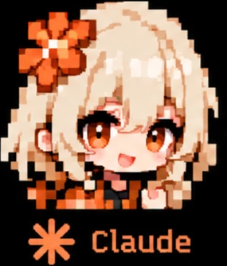 | 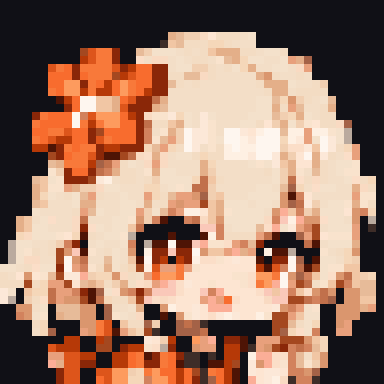 | `claude` | Claude · `[232, 118, 64]` | claude、sonnet、opus、haiku、anthropic | `source.webp` 第 1 格 | 浅米色长发，橙色花朵发饰，橙色眼睛，张嘴笑，双手握拳 |
| 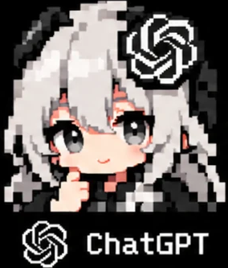 | 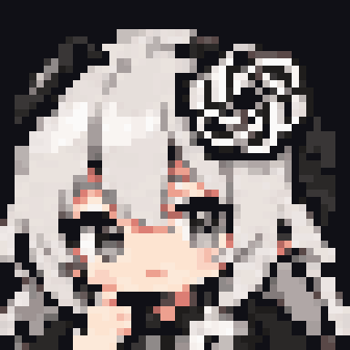 | `chatgpt` | ChatGPT · `[236, 236, 236]` | gpt、codex、openai、o3 这类 o 加数字 | `source.webp` 第 2 格 | 银灰色长发，黑白的 OpenAI 花结发饰，灰色眼睛，手托下巴，黑白衣服 |
|  | 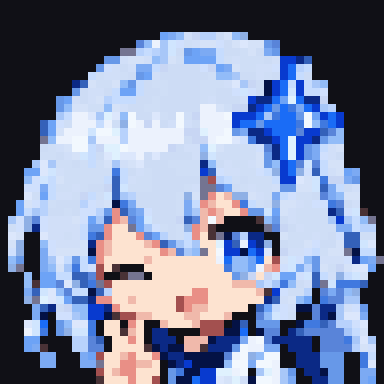 | `gemini` | Gemini · `[96, 156, 250]` | gemini、gemma | `source.webp` 第 3 格 | 浅蓝长发，蓝色四角星发饰，眨一只眼，比耶 |
|  |  | `deepseek` | DeepSeek · `[92, 120, 254]` | deepseek | `source.webp` 第 4 格 | 深蓝长发，小鲸鱼发饰，蓝色眼睛，微笑 |
| 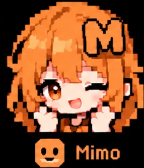 |  | `mimo` | MiMo · `[245, 140, 50]` | mimo、xiaomi | `source.webp` 第 5 格 | 橙色长发，M 字发饰，眨一只眼，双手握拳打气 |
| 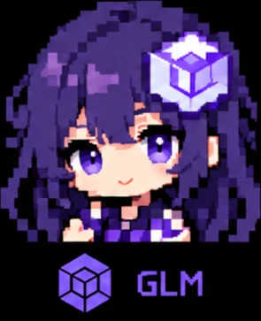 |  | `glm` | GLM · `[128, 104, 236]` | glm、zhipu | `source.webp` 第 6 格 | 深紫长发，立方体发饰，紫色眼睛，微笑，紫色格子衣服 |
| 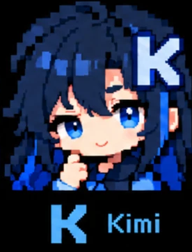 | 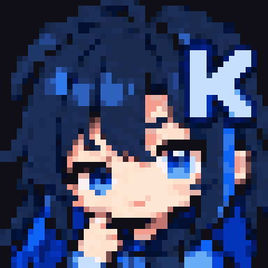 | `kimi` | Kimi · `[110, 170, 250]` | kimi、moonshot | `source.webp` 第 7 格 | 藏青长发，K 字发饰，蓝色眼睛，手托下巴 |
| 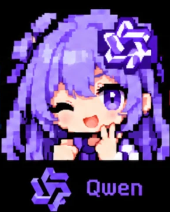 |  | `qwen` | Qwen · `[140, 116, 246]` | qwen、qwq、qvq | `source.webp` 第 8 格 | 淡紫长发，Qwen 标志发饰，眨一只眼，比耶 |
| 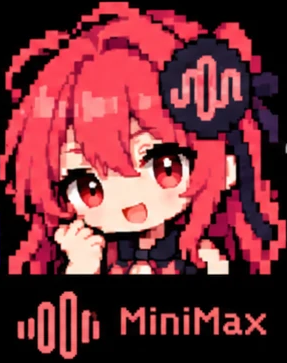 | 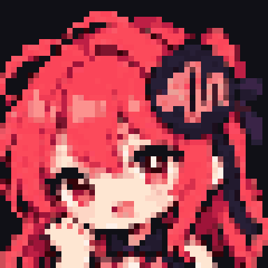 | `minimax` | MiniMax · `[240, 84, 84]` | minimax、abab | `source.webp` 第 9 格 | 红色长发，黑色圆形声波发饰，红色眼睛，张嘴笑，双手握拳 |
| 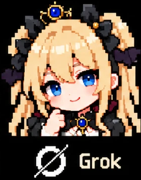 | 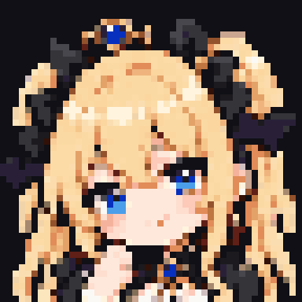 | `grok` | Grok · `[236, 208, 140]` 淡金色 | grok、xai、x-ai | `source-grok.webp` 第 10 格 | 金色双马尾，黑色蝴蝶结，头顶小王冠镶蓝宝石，蓝色眼睛，微笑，黑色洋装配蓝宝石胸针 |
| 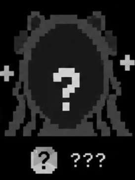 | 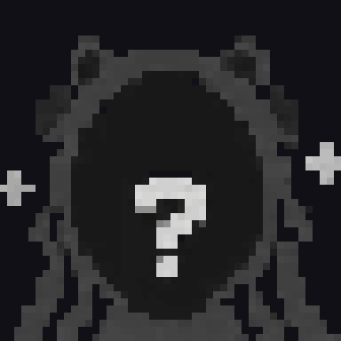 | `unknown` | ??? · `[150, 150, 150]` | 以上都认不出时 | `source.webp` 第 10 格 | 灰色剪影，脸上一个问号，两侧有小十字星 |

几点说明：
- **Grok 的名牌颜色**：参考图上 Grok 的名牌是白色，但 ChatGPT 已经用了近白色，同场时分不出来，所以改用头发和王冠的淡金色。
- **Claude 和 Grok 的区分**：两人都是金色系头发。Claude 靠橙色花朵和橙色眼睛，Grok 靠王冠、黑蝴蝶结和蓝眼睛；36×36 里也分得开。
- **没有模型名时**：Codex 用 ChatGPT 的头像，其他接入方式用 ???。

## 加新角色

1. **参考图**：画成和现有参考图一样的版式（黑底、每行 5 个、像素格约 11.6px、下面带名牌），存成 `tools/avatars/` 下的新文件，不要覆盖旧图。
2. **取样**：在 `make-avatars.mjs` 的 `DEFAULT_SHEETS` 里加一行，名单里不用的格子写 `-`。运行上面的命令后核对：已有角色的数据应该一个字节都不变，新角色的预览图和卡片看起来要对。
3. **代码**：`watch-intro.mjs` 的 `AVATAR_RULES` 加关键字，`LOOKS` 加名牌和颜色；`messages.mjs` 的 `introModelJokes` 中英文各加两句笑话；`tests/intro.test.mjs` 加几个模型名的例子。以上都要在 `foreman-en/` 里同样改一遍。
4. **核对效果**：在终端里实际放一次启动动画，重点看中尺寸里和颜色相近的角色分不分得开。
5. **更新本文件**：在上面的角色表里加一行。
